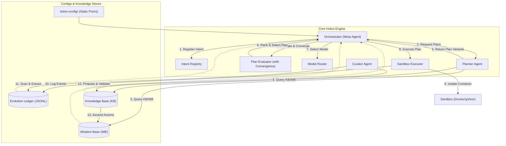

### architecture.md

This document describes the **Holon / FIEE (Fractal Intent Evolution Engine)** architecture: a self-evolving, git-native
multi-agent system that plans competitively, executes in sandboxes, and improves via measured feedback loops.

#### Scope

- What the system is made of (components + responsibilities)
- How work flows (intent → plans → execution → measurement → learning)
- Where invariants live (git discipline, metric “physics”, autonomy boundaries)
- How routing works (different models for different work, as a selection pressure)

---

### Core invariants (non-negotiable)

#### 1) Git is the universal state machine

- All intents, plans, executions, and outcomes are represented as git artifacts.
- Agents never “just do work”; they **propose diffs**.

#### 2) Fractal intent (recursive, depth-capped)

- Any intent may spawn sub-intents recursively, in practice through the plan that decides the split, up to
  `MAX_SUB_INTENT_DEPTH` levels below the root intent.
- Sub-intents are first-class and follow the same rules as root intents.

#### 3) Competitive planning variants per intent

- Multiple plan variants compete as hypotheses.
- Plans are scored using shared “physics” metrics (P(success), ΔS, EV, Cost, Impact, LearningValue).

#### 4) Strict rebase discipline; deciding-node-only merges

- **Sub-intents rebase from their deciding node's branch (in practice the plan branch) before and after execution.**
- **Sub-intents may merge ONLY into that branch** (the plan branch, or the execution branch when an execution decided
  the split).
- **No direct merges from sub-intents to `main`.**
- Below the root no human intervention is needed: the agent raises and merges every sub-intent's PR automatically, and
  only the root intent's PR to `main` stops for a human. Until the implementation follows, the current flow still
  targets the parent intent branch and leaves each sub-intent PR merge to the maintainer (see [Git Flow](git_flow.md)
  Stage 3 under the flow equivalence guarantee).

#### 5) Sandboxed exploration is allowed (including risky)

- Risky exploration is allowed because it happens in disposable branches + sandboxes.
- The system is designed to **learn from failures**, not just avoid them.

#### 6) Metrics are “physics”

- Metric definitions are stable contracts.
- Estimators may evolve, but definitions, ranges, and ledger recording are immutable without explicit approval.

---

### Core architecture: The Stateless Engine

Holon operates as a **Stateless Engine**. It separates project-specific **Governance** (Priors) from **Experience**
(Memory) using two mandatory directories.

#### 1) `holon-config/` (The Static Priors)

Consolidates human-authored rules, agent identities, and project "physics".

- `prompts/`: Agent identities, missions, and persona templates.
- `schemas/`: Validation rules for the Ledger, KB, and Wisdom Base.
- `world/`: The project "Physics" context (`ruleset.md` and `constraints.md`).
- `rules/`: Programmatic safety and autonomy boundaries.
- `metrics/`: EV weights, coefficients, and estimator constants.

#### 2) `holon-knowledge/` (The Dynamic Experience)

Consolidates machine-authored history and the intelligence evolved from it.

- `ledger/`: The canonical 3-ledger append-only audit trail (`intents.jsonl`, `plans.jsonl`, `executions.jsonl`)
  protected by `LedgerLock`. Auxiliary ledgers (`actions.jsonl`, `reviews.jsonl`) are strictly retired. Micro-actions
  (`entry_type: "action"`, e.g. `ACT-REV`, `ACT-FIND`, `ACT-POST`) are chronologically interleaved alongside lifecycle
  summaries (`entry_type: "summary"`) in `executions.jsonl`.
- `kb/`: (Knowledge Base) Project-specific patterns, tactics, and failure modes.
- `wb/`: (Wisdom Base) Universal invariants and cross-project heuristics.

Agents and system components are **config-driven**; they are initialised with a `config_path` (defaulting to
`holon-config/`) and a `knowledge_path` (defaulting to `holon-knowledge/`).

### Agent CLI Versioning in the Validation Cycle

To guarantee reproducibility and full provenance, the stateless runner does not assume static agent environments.
Instead, when executing plans, it dynamically resolves the exact agent CLI version. The runner tries to query the binary
directly (using `--version`, `-v`, or `version` flags). If the execution environment does not have the binary or the
invocation fails, it falls back to the exact version declared in the orchestrator build environment (defined in
`apps/sandbox-executor/Dockerfile`). The resolved `agent_version` is embedded in the schema validation cycle for both
`plans.jsonl` and `executions.jsonl`, linking the exact binary version with predictions, calibration errors, and final
outputs.

---

### High-level architecture

The components of the Holon engine are organised around the Orchestrator (Meta-Agent), which coordinates the flow of
information between static configurations, dynamic data products, and execution runtimes.

#### Component map

- **Config Loader**
  - The entry point for the "Static Priors". Provides a unified API to access prompts, schemas, and the world definition
    from `holon-config/`.
- **Knowledge Loader**
  - The entry point for the "Dynamic Experience". Provides agents with the Ledger, KB, and WB from `holon-knowledge/`.
- **Intent Registry**
  - Stores intent metadata: IDs, parent/child links, state, constraints, trust requirements.
- **Planner (Variant Generator)**
  - Config-driven: Loads missions and project context from `holon-config/`.
  - Knowledge-driven: Utilises local patterns (KB) and universal reasoning (WB) from `holon-knowledge/`.
  - Produces multiple candidate **Plan Graphs** for the same intent.
- **Plan Evaluator**
  - Config-driven: Loads metric weights from `holon-config/metrics/`.
  - Scores plan variants using metrics + constraints defined in `holon-config/world/`.
- **Convergence Policy**
  - Config-driven: Loads thresholds from `holon-config/rules/`.
  - Decides when to stop generating new plan variants.
- **Router**
  - Selects model tiers per task, recorded as metadata.
- **Executor (Sandbox Runner)**
  - Config-driven: Loads safety rules from `holon-config/rules/`.
  - Knowledge-driven: Adheres to universal safety invariants from `holon-knowledge/wb/`.
  - Security-hardened: Dispatches containers with `--cap-drop=ALL` (stripping all kernel capabilities),
    `--security-opt=no-new-privileges` (preventing privilege escalation), and non-root execution (`holon` user, UID
    10001).
  - Git abstraction: Routes all repository interactions through `sandbox_executor.git` (`run_git`, `get_diff_numstat`,
    `resolve_ref`, `get_head_commit`, `branch_exists`) with automatic credential sanitisation and timeout enforcement.
  - Runs a chosen plan variant in an isolated environment.
- **Review Ensemble (Stage 4)**
  - `sandbox_executor/review_ensemble.py` runs independent reviewer agent turns, each in its own scratch directory under
    `.holon/review/` and blind to the other reviewers' reports, parses the strict JSON trailer that ends each report,
    and approves only by unanimity: every configured reviewer completed with `APPROVED` and zero findings, plus
    mergeable and green CI. Any failed reviewer, zero completed reviewers or unknown CI can never approve.
    `run_review_loop()` calls it once per iteration on the real diff (`--ensemble-size`, default 3), stops at the first
    iteration that is not approved (there is no automatic resolver), and `sandbox_executor/review_report.py` renders the
    posted report from the real reviewer results. Reviewer turns run only inside the sandbox: on the host the loop
    refuses before any PR, iteration or post. See the
    [sandbox-executor README](../apps/sandbox-executor/README.md#reviewer-ensemble).
- **Evolution Ledger (Canonical 3-Ledger Architecture)**
  - Knowledge-driven: Strictly maintains three append-only ledgers in `holon-knowledge/ledger/`:
    1. `intents.jsonl`: Intent registrations, goals, constraints, and hierarchy links.
    2. `plans.jsonl`: Competing plan proposals, predictions, and model routing metadata.
    3. `executions.jsonl`: Execution summaries, Stage 4 PR review summaries, and fine-grained micro-actions
       (`entry_type: "action"`, e.g. `ACT-REV`, `ACT-FIND`, `ACT-POST`, historical `ACT-RES` rows and the Stage 5
       `ACT-CAL`). See the flow stage record matrix in `docs/ledger_schema.md`.
  - Retirement of auxiliary ledgers: Auxiliary ledgers such as `actions.jsonl` and `reviews.jsonl` are completely
    retired and prohibited.
  - Concurrency & Interleaving Protection: All ledger appends are guarded by `LedgerLock` (POSIX advisory file locking
    via `fcntl.flock` with exponential backoff and explicit fsync), preventing race conditions or interleaved torn
    writes.
  - Validates events against `holon-config/schemas/`.
- **Knowledge Base (Read/write store)**
  - Knowledge-driven: Stores patterns and tactics in `holon-knowledge/kb/`.
  - Validates entries against `holon-config/schemas/`.
- **Wisdom Base (Global Store)**
  - Knowledge-driven: Stores universal axioms in `holon-knowledge/wb/`.
  - Meta-evolving: Universal knowledge that "ascends" from local KBs.
- **Meta-Agent / Orchestrator**
  - Initialised with `config_path` and `knowledge_path`.
  - Watches for new work, dispatches planner/executor jobs, enforces git discipline and budgets.
- **Human Review Boundary**
  - Where humans approve promotions (only the root intent's PR to `main`; see
    [Branch topology and authority boundaries](#branch-topology-and-authority-boundaries) for the current
    implementation).

---

### Data products: Ledger vs Knowledge Base

#### Evolution Ledger (append-only, forensic)

- Purpose: auditability and measurement.
- Stores:
  - intent_id, plan_id, variant_id
  - predicted metrics (P(success), ΔS, Impact, Cost, LearningValue, EV)
  - routing decision (model_id, tier, reason)
  - execution logs and outcomes
  - git commit SHAs / diffs
  - post-execution measurements + calibration errors

#### Knowledge Base (curated, reusable)

- Purpose: accelerate future planning and improve estimators.
- Stores:
  - proven tactics/patterns (“playbooks”)
  - common failure modes + mitigations
  - reusable code snippets/modules
  - estimator proposals, comparisons, and approvals
  - routing heuristics and observed ROI

#### Instrumentation for Selection Pressure

The system treats the `model` metadata as an evolvable trait. By recording architectural attributes (e.g.,
`tuning_type`, `parameter_class`, `reasoning_mode`), the **Researcher Agent** can extract "Wisdom" that generalises
across model providers. This ensures that the system evolves toward the most efficient **Architecture + Tactic**
pairings, rather than just chasing specific model IDs. Detailed instrumentation of modalities and runtime configurations
enables the system to penalise inefficient resource usage (e.g., using vision for text-only tasks) and reward
high-fitness pairings.

---

### End-to-end lifecycle (intent → learning)

#### 1) Intent creation

An intent is created by one of:

- **Human root intent** (bootstrap and high-level goals)
- **Trusted agent root intent** (autonomous goal-setting; gated by trust)
- **Reactive/system intent** (triggered by failures, conflicts, regressions)

Each intent includes:

- goal statement
- constraints (entropy budget, cost budget, time budget, trust requirements)
- scope boundaries (allowed modules, forbidden modules, sandbox requirements)
- parent pointer (unless root)

#### 2) Competitive planning (plan variants)

For each intent, the planner generates plan variants:

- Each variant is a structured plan graph (steps + dependencies + sub-intents)
- Each variant includes predicted:
  - P(success)
  - ΔS (entropy)
  - Impact
  - LearningValue
  - Cost
  - EV

Variants are recorded even if rejected.

#### 3) Plan evaluation + selection

The evaluator:

- validates plan feasibility (dependency availability, tool availability, sandbox constraints)
- scores each variant via EV
- chooses the current best variant
- triggers **convergence** if further planning is unlikely to improve EV meaningfully

#### 4) Routing (model selection)

The router selects model tier per role/task:

- Low-entropy, low-novelty tasks → fast/cheap model (e.g., “Flash” class)
- High-entropy, high-novelty, high-impact tasks → deeper model (e.g., “DeepThink” class)

Routing decisions are logged with full "DNA" metadata:

- model architecture, tuning type, and parameter class
- active modalities and reasoning modes
- routing_reason and expected_roi
- selection_method (e.g., `autonomous_router` or `explicit_manual`)

Routing becomes a **selection pressure**: better routing improves ROI. The system learns to associate specific task
characteristics with the architectural traits that yield the highest EV.

#### 5) Execution (sandboxed)

Executor:

- creates a sandbox environment
- checks out the correct branch
- enforces git discipline (rebase rules)
- runs plan steps (may spawn sub-intents where permitted)
- produces code changes, tests, artifacts, logs

#### 6) Measurement (post-execution)

After execution:

- measure actual P(success) (binary success/failure per intent definition)
- measure actual ΔS from diff + dependency changes + conflicts + coverage deltas
- measure actual Impact (domain-specific)
- measure actual LearningValue (epistemic gain)
- compute calibration error for predictions

All results are appended to the ledger.

#### 7) Learning / KB update

Curate:

- if successful: extract reusable patterns into KB
- if failed: extract failure modes and mitigation steps
- if predictions were off: propose estimator improvements (requires approval)

---

### Branch topology and authority boundaries

#### Principle: merges flow up to the deciding node

- A sub-intent branch nests under, is cut from and merges into the branch of its deciding node: the intent, plan or
  execution branch whose stage decided the split (in practice the plan branch; `target_branch` equals
  `deciding_branch`).
- Any level (intent, plan, execution, review) may decide a split, but in practice the plan does. A split decided during
  review may nest under the reviewed plan or execution.
- The deciding node's branch is the integration surface for its sub-intents.
- Siblings under one deciding node always have different slugs, so their ids cannot collide.
- Only the root intent's PR merges into `main`.
- Until the implementation follows, the current flow still cuts each child from and targets the parent intent branch and
  leaves each sub-intent PR merge to the maintainer (see [Git Flow](git_flow.md) Stage 3 under the flow equivalence
  guarantee).

#### Human review boundary

Human review occurs at:

- root intent completion (its PR to `main`, the only human stop in the flow; see the current-implementation note above)
- estimator definition updates
- trust/autonomy level changes
- changes to “physics” or governance modules

---

### Planning convergence policy (architecture role)

Convergence prevents infinite planning loops. For a detailed breakdown of convergence triggers, mathematical
definitions, and termination thresholds, see the
[Convergence & Termination Policies in planning_and_evaluation.md](planning_and_evaluation.md#L186).

Convergence triggers may include:

- **EV plateau:** incremental EV gains fall below threshold for N variants
- **entropy budget exhausted:** predicted ΔS exceeds remaining budget
- **dominant plan:** a plan wins by margin and confidence is high
- **planning cost cap:** planning spend exceeds configured cost/time limits

Convergence outcome:

- select best-known plan variant
- record convergence reason + final plan set

---

### Autonomy and trust levels (corrected: intent proposal is privileged)

Holon autonomy is staged such that **work is broadly allowed**, but **goal-setting is gated**.

#### Baseline (low trust / default agent)

- Agent can generate **plans** (variants) for assigned intents.
- Agent can execute **actions** inside sandbox for assigned intents, within budgets.
- Agent cannot create new root intents.
- Agent can propose sub-intents only if the parent intent policy allows it (often “no” at first).

Rationale: executing bounded work in a sandbox is safer than inventing new goals.

#### Medium trust (decomposition allowed)

- Agent can spawn **sub-intents** during planning/execution, subject to:
  - parent intent constraints
  - entropy/cost budgets
  - mandatory rebase + deciding-node-only merge rules
- Agent still cannot propose new root intents.

#### High trust (autonomous goal-setting)

- Agent can propose **new root intents** (agent-generated intents) that enter the same validation pipeline:
  - predicted metrics (P(success), ΔS, Impact, Cost, LearningValue, EV)
  - justification + alignment constraints
  - explicit scope boundaries
- Root-intent proposals may still require human acceptance depending on configuration.

#### Highest trust (governance proposals; still human-approved)

- Agent can propose changes to:
  - estimator implementations
  - routing heuristics
  - governance policies
- Human approval remains required for any changes that affect metric definitions (“physics”) or system invariants.

#### Trust is earned via measurement

Trust level is influenced by:

- calibration quality (P(success), ΔS, Impact)
- rate of successful intent completion
- compliance with git discipline
- safety violations (immediate penalties)

---

### Minimal module map (conceptual)

- `core/`
  - intent model, plan model, IDs, invariants
- `planning/`
  - variant generation, plan graph, convergence policy
- `routing/`
  - model router, routing evaluation
- `execution/`
  - sandbox runner, tool adapters, rebase enforcer
- `metrics/`
  - estimators, post-measurement, calibration
- `holon-knowledge/ledger/`
  - append-only event logging, schemas
- `holon-knowledge/kb/`
  - curated knowledge, retrieval APIs, write rules
- `holon-knowledge/wb/`
  - universal invariants, cross-project heuristics
- `orchestrator/`
  - meta-agent loop, scheduling, work queue

---

### Interfaces (what components exchange)

#### Intent → Planner

- intent_id
- goal + constraints
- context pointers (KB/WB refs + ledger summaries)
- allowed tool/model set

#### Planner → Evaluator

- plan_variants[] (each with predicted metrics + structure)

#### Evaluator → Router

- chosen plan variant + task decomposition with complexity/entropy cues

#### Router → Executor

- model assignments per subtask
- routing metadata

#### Executor → Ledger

- diffs, SHAs, logs
- predicted vs actual metrics
- outcomes and errors

#### Ledger/K.B./W.B. → Planner

- retrieved patterns and universal invariants
- prior similar intents + outcomes
- estimator versions and calibration stats

---

### Notes on extensibility

This architecture is intentionally modular:

- you can replace planners, routers, estimators without rewriting the whole system
- the ledger remains the stable audit backbone
- KB evolves slowly and deliberately to avoid poisoning

---

### What this architecture optimises for

- auditability (every action has a trace)
- safety through containment (sandbox + branch discipline)
- continuous improvement (calibration + selection pressure)
- scalable delegation (fractal intent, authority boundaries)
- efficient inference spend (routing as evolution)

---

### Complexity Gate and Ratchet Baseline

To safeguard long-term maintainability and prevent structural decay across `apps/sandbox-executor/src`, function
complexity is continuously gated via Ruff complexity lints and an automated test ratchet.

#### Complexity Thresholds and Rules

The following complexity rules and thresholds are enforced:

- **McCabe Cyclomatic Complexity (`C901`)**: `max-complexity = 10`. Restricts cyclomatic path complexity within any
  single function.
- **Pylint Return Statements (`PLR0911`)**: Maximum `6` return statements per function (Ruff default).
- **Pylint Branch Count (`PLR0912`)**: Maximum `12` branches per function (Ruff default).
- **Pylint Argument Count (`PLR0913`)**: Maximum `5` arguments per function definition (Ruff default).
- **Pylint Statement Count (`PLR0915`)**: Maximum `50` statements per function body (Ruff default).

#### Architectural Rationale: Inline Baseline vs. Per-File Ignores

Rather than configuring blanket `per-file-ignores` in `pyproject.toml`, existing legacy functions that exceed these
limits are annotated with inline `# noqa: <codes>` comments directly on their `def` lines:

1. **Function-Level Granularity**: `per-file-ignores` exempt whole files, allowing new or unannotated functions in those
   files to accumulate unchecked complexity. Inline annotations localize suppressions strictly to offending functions.
2. **Explicit Technical Debt Visibility**: Placing `# noqa` comments directly at the function declaration makes
   complexity immediately visible during code reading and PR reviews, signaling to developers where refactoring is
   needed.
3. **Configuration Stability**: Keeping `pyproject.toml` declarative and minimal avoids configuration churn and merge
   conflicts in project configuration files.

#### Ratchet Enforcement

The complexity gate is protected by an automated ratchet test at `apps/sandbox-executor/tests/test_complexity_gate.py`:

- The test scans all Python files in `apps/sandbox-executor/src` and counts the inline complexity `# noqa` directives
  (`C901`, `PLR0911`, `PLR0912`, `PLR0913`, `PLR0915`) on function definitions.
- The total count cannot exceed the established baseline (`BASELINE_COMPLEXITY_NOQA_COUNT = 187`,
  `BASELINE_ANNOTATED_FUNCTIONS_COUNT = 91`).
- Any new complex code or unauthorized `# noqa` directive fails CI.
- When legacy functions are simplified or refactored, the baseline constant must be ratcheted down, ensuring codebase
  complexity only decreases over time.
