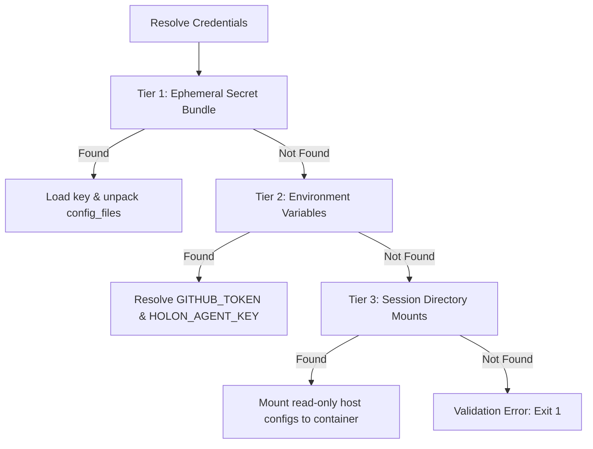

# Agent Credentials & API Key Requirements

To maintain a secure and decoupled sandbox model, the Sandbox Executor does not hardcode api keys or sensitive
configuration files. Instead, it utilizes a multi-tier fallback system to retrieve and configure credentials at runtime
before starting any AI agent.

---

## The 3-Tier Fallback Contract

Credentials resolution follows three distinct fallback tiers, which are queried in sequence:

### Tier 1: Ephemeral Secret Bundle

- **Source**: Resolved from the file path specified in `HOLON_SECRET_BUNDLE_PATH` (defaults to
  `/run/secrets/holon_auth.json`).
- **Use Case**: Typically used in automated CI/CD pipelines or orchestrated sandbox grids where credentials are
  provisioned dynamically for a single execution.
- **Handling**:
  - The executor reads and parses the JSON secret bundle. Container images must have `jq` installed to support
    credential extraction.
  - If `jq` is not found on `PATH` when a secret bundle is present, `role_dispatcher.sh` emits an actionable warning to
    `stderr` identifying the bundle path and noting that downstream agent authentication may fail, rather than silently
    skipping.
  - Skills and host scripts invoking `gh --jq` rely on the GitHub CLI's built-in Go parser/templating and do not require
    a host `jq` binary installed.
  - Parsing is resilient under `set -euo pipefail`: if the bundle contains malformed JSON, a warning is logged to
    `stderr` and container startup proceeds without terminating.
  - If the bundle includes an `api_key` or `token`, it is written to the `HOLON_AGENT_KEY` environment variable.
  - If the bundle includes a `config_files` dictionary, its key-value pairs (relative paths to file contents) are
    unpacked into the sandbox user's home directory.

#### Path Traversal Protection

During the unpacking of configuration files from the ephemeral secret bundle, a path-traversal safeguard is strictly
enforced to prevent malicious or malformed bundles from writing files outside the sandbox user's home directory (e.g.
overwriting `/etc/shadow` or `/usr/bin/`).

- **Validation Logic**:
  1. The target path is constructed via `os.path.abspath(os.path.expanduser(rel_path))`.
  2. The sandbox home directory is retrieved via `os.path.abspath(os.path.expanduser("~"))` and appended with a
     directory separator.
  3. The target path is verified to ensure it strictly starts with the resolved home directory prefix.
  4. If the target path attempts to write outside the home directory, a `ValueError` is raised, and the execution is
     aborted.

---

### Tier 2: Environment Variables

- **Source**: Environment variables forwarded directly to the container/process.
- **Key Variables**:
  - `HOLON_AGENT_KEY`: The primary API key or bearer token used by the agent runner.
  - `HOLON_AGENT_OSS_MODE`: Set to `true` or `1` to run agents in offline or open-source modes without requiring
    external API keys.
  - `HOLON_AGENT_PROVIDER`: Specifies the target model provider (e.g., `openai`, `anthropic`, `google`).
  - `HOLON_AGENT_SETTINGS`: Custom JSON or file-path configurations passed directly to the agent.
  - `HOLON_REPO_URL`: (Optional override). The target git repository URL, which never carries credentials. The `./holon`
    host CLI resolves the active repository remote (`remote.origin.url`). When `find_github_token()` finds a token, the
    remote is normalised to a plain HTTPS URL (`https://<host>/<org>/<repo>.git`). If no token is detected, the remote
    URL is forwarded as is to allow SSH agent forwarding. Setting `HOLON_REPO_URL` on the host serves as an explicit
    override. If the override or an HTTP(S) origin embeds credentials (`https://x-access-token:<token>@...`), the CLI
    strips them with a warning that names the source but never the value. The stripped credential is then used in
    preference to the ambient `find_github_token()` token, because it is scoped to that remote's host. A remote that
    stays plain `http://` is never sent a credential, so its stripped credential is discarded with a warning instead.
    Only the password, or a bare user name shaped like a GitHub token (`https://<token>@...`), counts as a credential. A
    plain user name (`https://<user>@...`) is a login name: it is stripped silently and the ambient token applies.
  - `GITHUB_TOKEN` / `GH_TOKEN`: Authenticates git fetch and push operations. The `./holon` host CLI automatically
    retrieves this token using `find_github_token()`, falling back to the local `gh` CLI credentials if not set in the
    environment. It reaches the container as described in
    [How the GitHub token reaches the container](#how-the-github-token-reaches-the-container).

#### How the GitHub token reaches the container

The token is kept out of every process's arguments, where `ps` and `/proc/<pid>/cmdline` could read it, and out of every
file inside the workspace:

1. **`0600` env-file.** `run_docker_container` splits the variables it forwards. Credential variables go into a
   temporary docker `--env-file`. These are `GITHUB_TOKEN`, `HOLON_AGENT_KEY`, `HOLON_MITM_WEB_PASSWORD`, any name the
   shared key regex recognises (for example `*_TOKEN`, `*_SECRET` and `*_API_KEY`), and any value that carries a
   credential, such as a proxy URL with userinfo. The file is created with mode `0600` in the owner-only (`0700`)
   directory `~/.holon/tmp/env-files`. It is removed when the run ends, whether through success, failure, an exception
   or an interrupt. Files left behind by a killed run are swept after 24 hours. Docker reads the file on the client
   side, so no bind mount is needed. A value containing a line break is rejected, because the env-file format has no
   quoting.
2. **Runtime credential helper.** For an HTTPS remote, the CLI also passes `GIT_CONFIG_COUNT`, `GIT_CONFIG_KEY_<n>` and
   `GIT_CONFIG_VALUE_<n>` (git 2.31 or later). These configure a `credential.https://<host>.helper` that answers with
   `username=x-access-token` and the value of `$GITHUB_TOKEN` from the container environment. They hold only that
   variable reference, so they are safe on the command line. The configuration exists only in the process environment,
   never in `.git/config` or any tracked file. The helper is scoped to the one host the token was previously embedded
   for. An override URL that never carried a credential gets no helper.

A preserved workspace (`HOLON_KEEP_WORKSPACE=1`) cloned under the old scheme keeps the tokenised URL as its `origin`.
That URL no longer matches, so the workspace is re-cloned, which also removes the persisted token.

#### Redaction of command and environment echoes

Every echoed command goes through one shared pattern set in `sandbox_executor.redaction`. This covers the host
`Executing: docker run ...` line, the in-sandbox `Running: git clone ...` lines and their failure diagnostics, and the
mitmproxy sidecar's failure output. The same pattern set redacts ledger records and agent output. Credentials are
replaced with the fixed marker `*******`, while the repository, branch and command shape stay readable (for example
`https://*******@github.com/<org>/<repo>.git`). Never add a second, divergent pattern set; extend that module instead.

The repository-wide test in `apps/sandbox-executor/tests/test_pre_commit_check.py` fails if any tracked file contains a
GitHub token shape or an `x-access-token:` URL credential.

#### Follow-up: mitmweb dashboard password

`HOLON_MITM_WEB_PASSWORD` is kept out of the agent container's arguments and masked in every echo. However, it is still
passed to the mitmproxy sidecar as `--set web_password=<password>` on that container's command line. A proposed
follow-up intent would mount a `0600` mitmproxy `config.yaml` into the sidecar instead. The dashboard is bound to
loopback, so the exposure is limited to local process listings.

---

### Tier 3: Session Directory Mounts

- **Source**: Host credential directories mounted read-only (`:ro`) into the corresponding paths inside the container
  user's home folder (`/home/holon/`).
- **Use Case**: Enables seamless developer experience when executing containerized runs locally, reusing credentials
  stored on the host.
- **Mapping (Host -> Container)**:
  - **Antigravity**: `~/.gemini/antigravity-cli` -> `/home/holon/.gemini/antigravity-cli` & `~/.config/antigravity` ->
    `/home/holon/.config/antigravity`
  - **Claude**: `~/.config/claude` -> `/home/holon/.config/claude`
  - **Codex**: `~/.codex` -> `/home/holon/.codex`
  - **Pi**: `~/.config/pi` -> `/home/holon/.config/pi`
  - **Gemini**: `~/.config/gcloud` -> `/home/holon/.config/gcloud`

---

## Agent-Specific Requirements & Configuration Mappings

Each agent has specific command-line structures and validation routines:

### 1. `antigravity`

- **Binary**: `agy`
- **Command template**: `agy --model <model_name> --effort <HOLON_AGENT_EFFORT> -p <prompt>`
- **Effort Evaluation**: The `--effort` argument (e.g., `medium`, `high`) is resolved dynamically at runner execution
  time to support runtime environment changes.
- **Validation**: Requires `HOLON_AGENT_KEY` to be set, or an active session directory mounted to
  `/home/holon/.gemini/antigravity-cli` or `/home/holon/.config/gcloud`.

### 2. `gemini`

- **Binary**: `gemini`
- **Command template**: `gemini --model <model_name> -p <prompt>`
- **Validation**: Requires `HOLON_AGENT_KEY` to be set, or active gcloud credentials mounted to
  `/home/holon/.config/gcloud`.

### 3. `claude`

- **Binary**: `claude`
- **Command template**: `claude --model <model_name> --settings <HOLON_AGENT_SETTINGS> -p <prompt>`
- **Validation**: Requires `HOLON_AGENT_KEY` to be set, or active session configuration mounted to
  `/home/holon/.config/claude`.

### 4. `pi`

- **Binary**: `pi`
- **Command template**: `pi -p --model <model_name> --provider <HOLON_AGENT_PROVIDER> <prompt>`
- **Session directories**: pi >= 0.84 keeps provider definitions in `~/.pi/agent/models.json`;
  `~/.config/pi/models.json` is the legacy location. **Only `models.json` is mounted**, never the directory around it,
  because that directory also holds `auth.json`, `sessions/` and `run-history.jsonl`, which a sandboxed agent must not
  read.
- **Validation**: Requires `HOLON_AGENT_KEY` to be set, a mounted `models.json` (`/home/holon/.pi/agent/models.json` or
  the legacy path), or host-local model mode (see [Host-Local Model Endpoints](#host-local-model-endpoints)).

### 5. `opencode`

- **Binary**: `opencode`
- **Command template**: `opencode run --model <model_name> --agent <HOLON_AGENT_MODE> <prompt>`
- **Validation**: Requires the `HOLON_AGENT_KEY` environment variable.

### 6. `codex`

- **Binary**: `codex`
- **Command template**:
  `codex exec -m <model_name> [--oss] [--local-provider <HOLON_AGENT_LOCAL_PROVIDER>] [-c <HOLON_AGENT_CONFIG>] <prompt>`
- **Offline / Open-Source Mode**: If `HOLON_AGENT_OSS_MODE=true` is set, the `--oss` flag is appended, and API key
  validation is skipped.
- **Validation**: Requires `HOLON_AGENT_KEY` to be set, `HOLON_AGENT_OSS_MODE=true`, or an active credentials session
  directory mounted to `/home/holon/.codex`.

---

## Host-Local Model Endpoints

An inference server running on the host (vMLX, Ollama, LM Studio, vLLM, llama.cpp, SGLang) is unreachable from the
sandbox under its natural address: container loopback is the container itself, and the host's own LAN address is not
routable inside the container namespace. The only address that works is the Docker gateway, `host.docker.internal`,
which `holon` now maps with `--add-host=host.docker.internal:host-gateway` on every run so the behaviour is identical on
Docker Desktop and Linux.

Enable it explicitly:

| Variable                 | Purpose                                                                                                           |
| ------------------------ | ----------------------------------------------------------------------------------------------------------------- |
| `HOLON_LOCAL_LLM=1`      | Opt in. Never inferred from the contents of a config file.                                                        |
| `HOLON_LOCAL_BASE_URL`   | Endpoint used when the host has no `models.json` to copy (must include scheme, e.g. `http://localhost:11434/v1`). |
| `HOLON_LOCAL_PROVIDER`   | Provider name for the generated config (falls back to `HOLON_AGENT_PROVIDER`, then `local`).                      |
| `HOLON_LOCAL_MODELS`     | Comma-separated model ids served by that endpoint (required with `HOLON_LOCAL_BASE_URL`).                         |
| `HOLON_HOST_LOCAL_HOSTS` | Comma-separated authorities that may be rewritten (for example the host LAN IP).                                  |

When opted in, `holon` builds a temporary agent directory for the container. Local mode currently applies to the **pi**
runner only; with any other `--agent` it is ignored with a warning, because the artifact produced is a pi agent
directory.

1. The host `models.json` is read from `~/.pi/agent` (falling back to `~/.config/pi`), or synthesized from
   `HOLON_LOCAL_BASE_URL` / `HOLON_LOCAL_MODELS` when absent.
2. Each provider `baseUrl` is rewritten to the gateway **only if** its authority is loopback (the whole `127.0.0.0/8`
   range and `::1`, not merely `127.0.0.1`) or explicitly declared in `HOLON_HOST_LOCAL_HOSTS`. Every other field of a
   kept provider is preserved.
3. **Providers that are not host-local are dropped from the generated file.** It is mounted into the sandbox, so copying
   a cloud provider would carry its literal `apiKey` across that boundary for an endpoint the run cannot use. If no
   provider qualifies, the synthesized endpoint is used instead.
4. The directory is mounted read-write at `/home/holon/.holon-pi-agent` and exported as `PI_CODING_AGENT_DIR`; the host
   `models.json` is deliberately **not** mounted. Modes are set for the container user (uid 1000), not the host user --
   `0777` directory and `0644` file, applied at creation time rather than tightened afterwards -- and are safe precisely
   because step 3 keeps credentials out of the file.
5. Because the endpoint now resolves through the gateway, it is added to `NO_PROXY` when the token-reduction sidecar is
   active; local traffic is therefore never intercepted, cached, or recorded in the wire logs. With the sidecar the bare
   `host.docker.internal` name is exempted as well, since some `NO_PROXY` implementations compare hostnames only; that
   widening is skipped when an external proxy is itself reached through `host.docker.internal`, where it would disable
   proxying altogether.
6. If local mode cannot be satisfied (no host config and no `HOLON_LOCAL_BASE_URL`/`HOLON_LOCAL_MODELS`), the run aborts
   with an actionable error instead of starting an agent that could only fail later.

> [!WARNING] **No blanket RFC1918 rewriting.** Loopback and explicitly declared authorities only. A genuinely remote
> inference box on the same LAN must keep its address; silently redirecting it onto the host machine would change which
> model produced the agent's output without any signal that it had.

Because a local endpoint needs no provider credential, `validate()` accepts local mode in place of `HOLON_AGENT_KEY` for
**pi** -- the parity `codex` already had through `HOLON_AGENT_OSS_MODE`. The gate is pi-only on purpose: no other runner
receives the generated configuration, so a bypass for them would only convert a clear credential error into a confusing
mid-run failure. The opt-in alone is not sufficient either: an actual endpoint (`PI_CODING_AGENT_DIR` or
`HOLON_LOCAL_BASE_URL`) must be present, so a stray flag cannot mask a missing cloud key.
