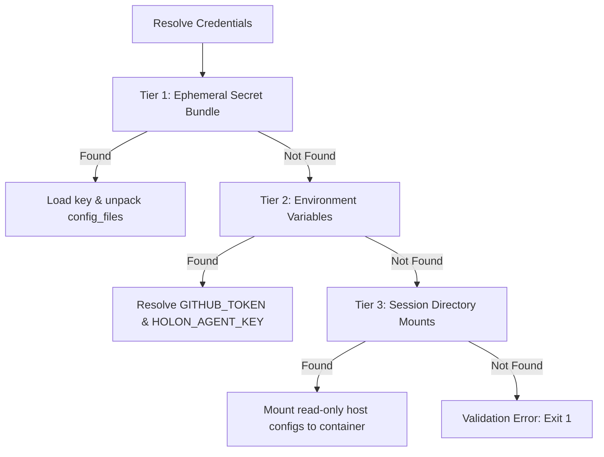

# Agent Credentials & API Key Requirements

To maintain a secure and decoupled sandbox model, the Sandbox Executor does not hardcode api keys or sensitive
configuration files. Instead, it utilizes a multi-tier fallback system to retrieve and configure credentials at runtime
before starting any AI agent.

---

## The 3-Tier Fallback Contract

Credentials resolution follows three distinct fallback tiers, which are queried in sequence:



### Tier 1: Ephemeral Secret Bundle

- **Source**: Resolved from the file path specified in `HOLON_SECRET_BUNDLE_PATH` (defaults to
  `/run/secrets/holon_auth.json`).
- **Use Case**: Typically used in automated CI/CD pipelines or orchestrated sandbox grids where credentials are
  provisioned dynamically for a single execution.
- **Handling**:
  - The executor reads and parses the JSON secret bundle. Container images must have `jq` installed to support
    credential extraction.
  - If `jq` is not found on `PATH` when a secret bundle is present, `role_dispatcher.sh` emits an actionable warning to
    `stderr` identifying the bundle path and noting that downstream agent authentication may fail, rather than silently
    skipping.
  - Skills and host scripts invoking `gh --jq` rely on the GitHub CLI's built-in Go parser/templating and do not require
    a host `jq` binary installed.
  - Parsing is resilient under `set -euo pipefail`: if the bundle contains malformed JSON, a warning is logged to
    `stderr` and container startup proceeds without terminating.
  - If the bundle includes an `api_key` or `token`, it is written to the `HOLON_AGENT_KEY` environment variable.
  - If the bundle includes a `config_files` dictionary, its key-value pairs (relative paths to file contents) are
    unpacked into the sandbox user's home directory.

#### Path Traversal Protection

During the unpacking of configuration files from the ephemeral secret bundle, a path-traversal safeguard is strictly
enforced to prevent malicious or malformed bundles from writing files outside the sandbox user's home directory (e.g.
overwriting `/etc/shadow` or `/usr/bin/`).

- **Validation Logic**:
  1. The target path is constructed via `os.path.abspath(os.path.expanduser(rel_path))`.
  2. The sandbox home directory is retrieved via `os.path.abspath(os.path.expanduser("~"))` and appended with a
     directory separator.
  3. The target path is verified to ensure it strictly starts with the resolved home directory prefix.
  4. If the target path attempts to write outside the home directory, a `ValueError` is raised, and the execution is
     aborted.

---

### Tier 2: Environment Variables

- **Source**: Environment variables forwarded directly to the container/process.
- **Key Variables**:
  - `HOLON_AGENT_KEY`: The primary API key or bearer token used by the agent runner.
  - `HOLON_AGENT_OSS_MODE`: Set to `true` or `1` to run agents in offline or open-source modes without requiring
    external API keys.
  - `HOLON_AGENT_PROVIDER`: Specifies the target model provider (e.g., `openai`, `anthropic`, `google`).
  - `HOLON_AGENT_SETTINGS`: Custom JSON or file-path configurations passed directly to the agent.
  - `HOLON_REPO_URL`: (Optional override). The target git repository URL. The `./holon` host CLI automatically resolves
    the active repository remote (`remote.origin.url`) and combines it with `find_github_token()` to forward an
    authenticated HTTPS URL (`https://x-access-token:<token>@<host>/<org>/<repo>.git`). If no token is detected, the raw
    remote URL is forwarded unchanged to allow SSH agent forwarding. Setting `HOLON_REPO_URL` on the host serves as an
    explicit override.
  - `GITHUB_TOKEN` / `GH_TOKEN`: Authenticates git fetch and push operations. The `./holon` host CLI automatically
    retrieves this token using `find_github_token()`, falling back to the local `gh` CLI credentials if not set in the
    environment. When present, it is combined with the discovered remote origin to construct an authenticated
    `HOLON_REPO_URL`.

---

### Tier 3: Session Directory Mounts

- **Source**: Host credential directories mounted read-only (`:ro`) into the corresponding paths inside the container
  user's home folder (`/home/holon/`).
- **Use Case**: Enables seamless developer experience when executing containerized runs locally, reusing credentials
  stored on the host.
- **Mapping (Host -> Container)**:
  - **Antigravity**: `~/.gemini/antigravity-cli` -> `/home/holon/.gemini/antigravity-cli` & `~/.config/antigravity` ->
    `/home/holon/.config/antigravity`
  - **Claude**: `~/.config/claude` -> `/home/holon/.config/claude`
  - **Codex**: `~/.codex` -> `/home/holon/.codex`
  - **Pi**: `~/.config/pi` -> `/home/holon/.config/pi`
  - **Gemini**: `~/.config/gcloud` -> `/home/holon/.config/gcloud`

---

## Agent-Specific Requirements & Configuration Mappings

Each agent has specific command-line structures and validation routines:

### 1. `antigravity`

- **Binary**: `agy`
- **Command template**: `agy --model <model_name> --effort <HOLON_AGENT_EFFORT> -p <prompt>`
- **Effort Evaluation**: The `--effort` argument (e.g., `medium`, `high`) is resolved dynamically at runner execution
  time to support runtime environment changes.
- **Validation**: Requires `HOLON_AGENT_KEY` to be set, or an active session directory mounted to
  `/home/holon/.gemini/antigravity-cli` or `/home/holon/.config/gcloud`.

### 2. `gemini`

- **Binary**: `gemini`
- **Command template**: `gemini --model <model_name> -p <prompt>`
- **Validation**: Requires `HOLON_AGENT_KEY` to be set, or active gcloud credentials mounted to
  `/home/holon/.config/gcloud`.

### 3. `claude`

- **Binary**: `claude`
- **Command template**: `claude --model <model_name> --settings <HOLON_AGENT_SETTINGS> -p <prompt>`
- **Validation**: Requires `HOLON_AGENT_KEY` to be set, or active session configuration mounted to
  `/home/holon/.config/claude`.

### 4. `pi`

- **Binary**: `pi`
- **Command template**: `pi -p --model <model_name> --provider <HOLON_AGENT_PROVIDER> <prompt>`
- **Session directories**: pi >= 0.84 keeps provider definitions in `~/.pi/agent/models.json`;
  `~/.config/pi/models.json` is the legacy location. **Only `models.json` is mounted**, never the directory around it,
  because that directory also holds `auth.json`, `sessions/` and `run-history.jsonl`, which a sandboxed agent must not
  read.
- **Validation**: Requires `HOLON_AGENT_KEY` to be set, a mounted `models.json` (`/home/holon/.pi/agent/models.json` or
  the legacy path), or host-local model mode (see [Host-Local Model Endpoints](#host-local-model-endpoints)).

### 5. `opencode`

- **Binary**: `opencode`
- **Command template**: `opencode run --model <model_name> --agent <HOLON_AGENT_MODE> <prompt>`
- **Validation**: Requires the `HOLON_AGENT_KEY` environment variable.

### 6. `codex`

- **Binary**: `codex`
- **Command template**:
  `codex exec -m <model_name> [--oss] [--local-provider <HOLON_AGENT_LOCAL_PROVIDER>] [-c <HOLON_AGENT_CONFIG>] <prompt>`
- **Offline / Open-Source Mode**: If `HOLON_AGENT_OSS_MODE=true` is set, the `--oss` flag is appended, and API key
  validation is skipped.
- **Validation**: Requires `HOLON_AGENT_KEY` to be set, `HOLON_AGENT_OSS_MODE=true`, or an active credentials session
  directory mounted to `/home/holon/.codex`.

---

## Readiness Probe (`holon doctor`)

`holon doctor` resolves the runner and model (see
[Runner and model resolution](../agents.md#runner-and-model-resolution)) and sends **one minimal real prompt** ("Reply
with the single word OK.") through that runner inside its normal container. The container gets the same session mounts,
gateway host entries and network isolation as a real run, and the same `HOLON_AGENT_KEY` mapping by the container
dispatcher. The probe never runs git and writes nothing to the repository or the ledgers.

```bash
holon doctor                                   # resolved runner and model
holon doctor --agent claude-agent --json       # structured output
holon doctor --timeout 120                     # default: HOLON_PREFLIGHT_TIMEOUT, then 60 seconds
```

Example output:

```text
Agent runner resolved to antigravity-agent (source: fallback, no --agent, HOLON_AGENT or harness marker)
Model resolved to gemini-3.8-flash-medium (source: table, default model for antigravity-agent)
Pre-flight antigravity-agent (gemini-3.8-flash-medium) via holon/agent-antigravity: QUOTA_EXHAUSTED
  exit code: 1
  hint: The provider reports exhausted quota or a rate limit. Wait for the quota to reset, or choose another runner with --agent or HOLON_AGENT.
```

After the probe report, `holon doctor` prints its environment section: the effective turn and stage budgets and, in
local-LLM mode, the model envelope and gateway probe (see
[`holon doctor` environment section](#holon-doctor-environment-section) below). With `--json` that section is carried as
`"environment": {"ok": <bool>, "lines": [...]}` next to `agent`, `model` and `preflight`. `holon doctor` exits `0` only
when the probe status is `ok` and the environment section found no local-LLM configuration error.

| Status            | Meaning                                                          | Remediation                                                                       |
| ----------------- | ---------------------------------------------------------------- | --------------------------------------------------------------------------------- |
| `ok`              | Exit 0 with an answer; an `OK` reply wins over any logged noise. | None.                                                                             |
| `quota_exhausted` | `429`, `RESOURCE_EXHAUSTED`, quota or rate-limit messages.       | Wait for the quota to reset, or choose another runner (`--agent`, `HOLON_AGENT`). |
| `not_logged_in`   | No `HOLON_AGENT_KEY` and no session to mount, or a login prompt. | Set `HOLON_AGENT_KEY` or initialise and mount the session (Tier 3 above).         |
| `expired_key`     | Expired or invalid key, `401`, `UNAUTHENTICATED`.                | Renew `HOLON_AGENT_KEY` or re-authorise the mounted session.                      |
| `unknown`         | Anything else, including a timeout or a rejected model name.     | Read the redacted output; check `--model` / `HOLON_MODEL` and the image.          |

Probe output is redacted before it is printed. A timeout usually means the runner is waiting for an interactive login.

### Gating of `plan`, `execute` and `flow`

`holon plan`, `holon execute` and `holon flow` run the same probe straight after resolving the runner and before any
container run, intent branch, push, checkpoint or ledger row. A status other than `ok` aborts the command with a
non-zero exit code. `holon flow --dry-run` never calls an agent, so it skips the probe. A flow resumed from
`--checkpoint` is probed with the checkpoint's recorded runner and model unless `--agent` or `--model` overrides them;
`--agent` without `--model` switches to the new runner's model (`HOLON_MODEL`, then its default) rather than keeping the
checkpoint's. `--from-stage` without a checkpoint resolves the runner as a fresh run does. A flow that resumes at
`review` or `calibrate` reaches no stage that calls the runner, so it skips the probe.

- `--skip-preflight` skips the probe for one command.
- `HOLON_SKIP_PREFLIGHT=1` skips it for every command, for example in CI. The host sets it for the containers it
  launches, so nested invocations never probe again.

Notes:

- Each probe costs one minimal real model call.
- With `--token-reduce`, the probe still goes straight to the provider; it does not start the proxy sidecar.
- In host-local model mode for `pi-agent` there is no provider quota or login to check, so the probe is skipped and
  reported as `ok`.

## Host-Local Model Endpoints

An inference server running on the host (vMLX, Ollama, LM Studio, vLLM, llama.cpp, SGLang) is unreachable from the
sandbox under its natural address: container loopback is the container itself, and the host's own LAN address is not
routable inside the container namespace. The only address that works is the Docker gateway, `host.docker.internal`,
which `holon` now maps with `--add-host=host.docker.internal:host-gateway` on every run so the behaviour is identical on
Docker Desktop and Linux.

Enable it explicitly:

| Variable                 | Purpose                                                                                                           |
| ------------------------ | ----------------------------------------------------------------------------------------------------------------- |
| `HOLON_LOCAL_LLM=1`      | Opt in. Never inferred from the contents of a config file.                                                        |
| `HOLON_LOCAL_BASE_URL`   | Endpoint used when the host has no `models.json` to copy (must include scheme, e.g. `http://localhost:11434/v1`). |
| `HOLON_LOCAL_PROVIDER`   | Provider name for the generated config (falls back to `HOLON_AGENT_PROVIDER`, then `local`).                      |
| `HOLON_LOCAL_MODELS`     | Comma-separated model ids served by that endpoint (required with `HOLON_LOCAL_BASE_URL`).                         |
| `HOLON_HOST_LOCAL_HOSTS` | Comma-separated authorities that may be rewritten (for example the host LAN IP).                                  |

When opted in, `holon` builds a temporary agent directory for the container. Local mode currently applies to the **pi**
runner only; with any other `--agent` it is ignored with a warning, because the artifact produced is a pi agent
directory.

1. The host `models.json` is read from `~/.pi/agent` (falling back to `~/.config/pi`), or synthesized from
   `HOLON_LOCAL_BASE_URL` / `HOLON_LOCAL_MODELS` when absent.
2. Each provider `baseUrl` is rewritten to the gateway **only if** its authority is loopback (the whole `127.0.0.0/8`
   range and `::1`, not merely `127.0.0.1`) or explicitly declared in `HOLON_HOST_LOCAL_HOSTS`. Every other field of a
   kept provider is preserved.
3. **Providers that are not host-local are dropped from the generated file.** It is mounted into the sandbox, so copying
   a cloud provider would carry its literal `apiKey` across that boundary for an endpoint the run cannot use. If no
   provider qualifies, the synthesized endpoint is used instead.
4. The directory is mounted read-write at `/home/holon/.holon-pi-agent` and exported as `PI_CODING_AGENT_DIR`; the host
   `models.json` is deliberately **not** mounted. Modes are set for the container user (uid 1000), not the host user --
   `0777` directory and `0644` file, applied at creation time rather than tightened afterwards -- and are safe precisely
   because step 3 keeps credentials out of the file.
5. Because the endpoint now resolves through the gateway, it is added to `NO_PROXY` when the token-reduction sidecar is
   active; local traffic is therefore never intercepted, cached, or recorded in the wire logs. With the sidecar the bare
   `host.docker.internal` name is exempted as well, since some `NO_PROXY` implementations compare hostnames only; that
   widening is skipped when an external proxy is itself reached through `host.docker.internal`, where it would disable
   proxying altogether.
6. If local mode cannot be satisfied (no host config and no `HOLON_LOCAL_BASE_URL`/`HOLON_LOCAL_MODELS`), the run aborts
   with an actionable error instead of starting an agent that could only fail later.

> [!WARNING] **No blanket RFC1918 rewriting.** Loopback and explicitly declared authorities only. A genuinely remote
> inference box on the same LAN must keep its address; silently redirecting it onto the host machine would change which
> model produced the agent's output without any signal that it had.

Because a local endpoint needs no provider credential, `validate()` accepts local mode in place of `HOLON_AGENT_KEY` for
**pi** -- the parity `codex` already had through `HOLON_AGENT_OSS_MODE`. The gate is pi-only on purpose: no other runner
receives the generated configuration, so a bypass for them would only convert a clear credential error into a confusing
mid-run failure. The opt-in alone is not sufficient either: an actual endpoint (`PI_CODING_AGENT_DIR` or
`HOLON_LOCAL_BASE_URL`) must be present, so a stray flag cannot mask a missing cloud key.

#### Model Envelope (Bean 0140)

Long authoring turns on local models used to stop at whatever output limit the agent assumed, because the generated
`models.json` carried only bare model ids. `prepare_agent_dir()` now gives every model entry an explicit envelope after
the rewrite above (the loopback and allow-list rewrite, `NO_PROXY` scoping and `PI_CODING_AGENT_DIR` are unchanged):

| Variable                       | Default | Purpose                                                                                 |
| ------------------------------ | ------- | --------------------------------------------------------------------------------------- |
| `HOLON_LOCAL_CONTEXT_WINDOW`   | (none)  | Context window for model entries that declare no `contextWindow` (synthesised configs). |
| `HOLON_CONTEXT_RESERVE_TOKENS` | `4096`  | Tokens kept free for the prompt: `maxTokens` may not exceed `contextWindow` minus this. |
| `HOLON_REASONING_MODE`         | `off`   | Reasoning mode for the generated entries: `off`, `minimal`, `low`, `medium` or `high`.  |

- **`maxTokens`.** When a model entry has no `maxTokens`, it is synthesised as `min(16384, contextWindow // 4)` and the
  model id, value and reason are logged. A host value is kept unless it is a bool, not an integer, zero, negative or
  larger than `contextWindow - HOLON_CONTEXT_RESERVE_TOKENS`, in which case the run aborts with `LocalLLMConfigError`
  naming the model and the field. A model with no `contextWindow` uses `HOLON_LOCAL_CONTEXT_WINDOW`; without either the
  run aborts rather than guessing a window, so configs synthesised from `HOLON_LOCAL_MODELS` need
  `HOLON_LOCAL_CONTEXT_WINDOW`.
- **Reasoning mode.** Resolved from `HOLON_REASONING_MODE`, then the host model entry, then `off` (the least-thinking
  mode, used by default for authoring stages). A host entry with `reasoning: false` always resolves to `off`, even when
  `HOLON_REASONING_MODE` asks for more (a warning is logged), because the model is declared unable to reason; a host
  string mode must be one of the allowed values. pi's `reasoning` field is a boolean capability flag, so the generated
  entry carries `reasoning: true` unless the mode is `off`, and the agent directory's `settings.json` sets
  `defaultThinkingLevel` to the least-thinking mode among the models. The mode and its source are logged.

##### `holon doctor` environment section

This is the environment section of the single `holon doctor` command, printed after the
[readiness probe](#readiness-probe-holon-doctor) report. It runs on the host and writes nothing. It prints the effective
budgets (see [Turn and Stage Budgets](../budgets.md)) and, when `HOLON_LOCAL_LLM` is enabled, for every model:

```text
model=<id> context=<n> max_tokens=<n> source=host|synthesised
reasoning=<mode> source=env|host|default
```

It then probes `<scheme>://<host>:<port>/health` once for each distinct host-side (pre-rewrite) server, with a 2 s
timeout and no proxy (providers that share a host and port, such as `/v1` and `/anthropic` on one server, share one
probe and one line), and prints `gateway=<url> prefill_cache=off|cold|warm` followed by any memory figures the server
reports. The cache is `off` when the server reports it disabled, `cold` when it is enabled with zero cached entries or
tokens, and `warm` otherwise; an unreachable server or an unrecognised response prints `prefill_cache=unknown` and never
fails the command. A `WARNING` line is printed when an emitted `maxTokens` exceeds the
`effective_defaults.max_output_tokens` of the server that serves that model, or when a model's `contextWindow` exceeds
that server's `max_prompt_tokens` (read from `effective_defaults` or the top level of the response); a model is never
compared with another server's limits. Only loopback or `HOLON_HOST_LOCAL_HOSTS` authorities are ever probed, and only
over `http` or `https` (a `file://` or `ftp://` `baseUrl` is skipped): redirects are refused, at most 1 MiB of the
response is read (a larger one prints `prefill_cache=unknown`), and the probe URL is rebuilt from host and port only, so
userinfo in a `baseUrl` is never sent or printed.
