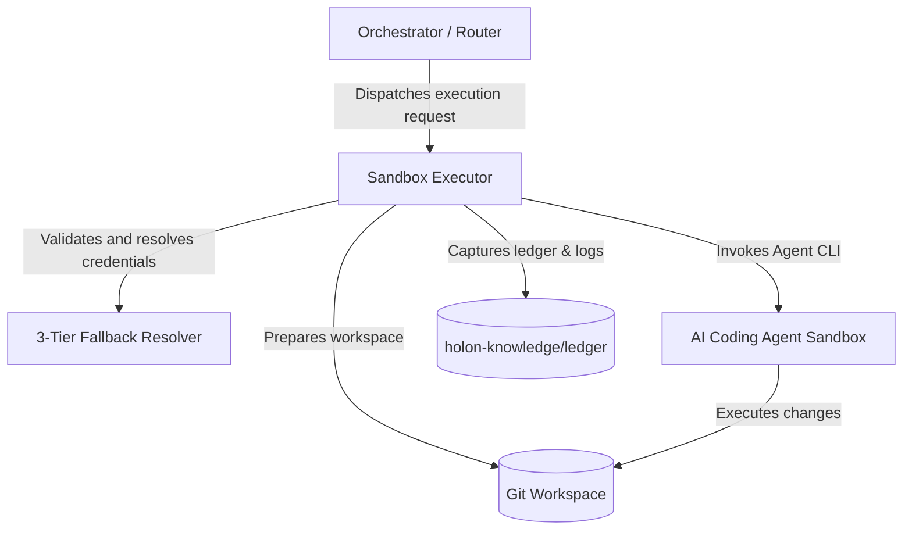
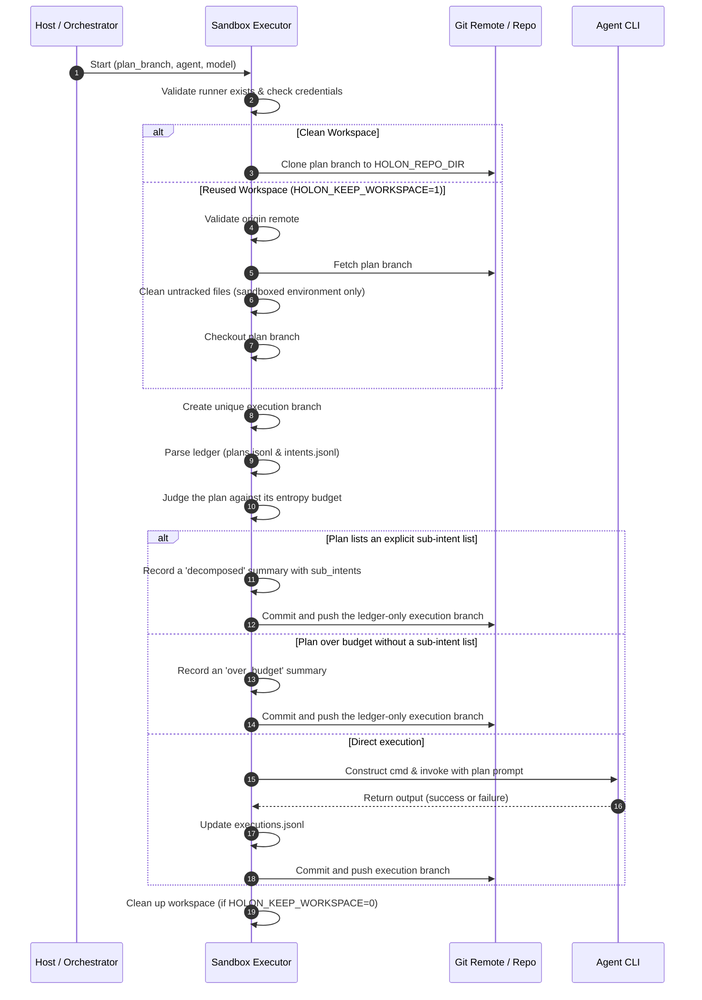

# Execution Architecture Specification

The **Sandbox Executor** is a critical component in the Holon Agentic Coder ecosystem. It is responsible for checking
out a plan branch, preparing the sandbox environment, invoking the target AI coding agent, capturing the execution logs
and results, writing records to the execution ledger, and committing and pushing the modifications back to the remote
repository.

---

## High-Level Architecture

The Sandbox Executor operates as a bridging layer between the orchestrating system and the containerized coding agent.



- **Orchestrator**: Dispatches intent and execution branches to the sandbox runner.
- **Sandbox Executor**: Runs within the execution sandbox (or on the host in local mode) to manage git state, agent
  configuration, safety checks, and ledger updates.
- **Sandboxes (Process / Container / VM)**: Provide environment isolation. In containerized environments, the executor
  runs inside specialized agent container images (e.g., `holon/agent-<agent_id>`).

---

## Execution Lifecycle Flow

The execution process follows a strict sequential lifecycle:



### 1. Runner Validation

The executor verifies that the chosen agent is registered in the runner registry and performs initial credential
validation under the **3-Tier Fallback Contract**.

### 2. Workspace Preparation

Depending on the environment configuration:

- **Dynamic Repository URL Resolution**: In containerized workflows, `HOLON_REPO_URL` is automatically resolved on the
  host by the `holon` CLI wrapper. It inspects the target repository's git remote (`git config --get remote.origin.url`,
  respecting `--repo-dir` and git worktrees) and normalizes SSH (`git@`, `ssh://`) or HTTPS formats. When paired with
  `find_github_token()`, an authenticated URL (`https://x-access-token:<token>@<host>/<org>/<repo>.git`) is constructed
  and forwarded to the container. If no token is detected, the raw remote URL is forwarded to enable SSH agent
  forwarding.
- **Host Override & Fail-Fast**: Exporting `HOLON_REPO_URL` on the host serves as an optional override that takes
  absolute precedence. If the host CLI cannot resolve an `origin` remote and no override is present, it fails fast with
  a descriptive error and exits non-zero before invoking Docker.
- **Container-Side Strict Contract**: Inside the execution container, `get_repo_url()` strictly reads `HOLON_REPO_URL`.
  If it is unset or empty, it raises an explicit `RuntimeError`. Silent fallbacks to hardcoded repositories (such as
  `holon-agentic-coder.git`) have been completely eliminated.
- **Clean Workspace**: If `HOLON_REPO_DIR` is empty or not configured, a default workspace is initialized (either
  `~/.holon-sandbox/workspace` in sandbox mode or `~/.holon/repo` locally).
- **Stale Workspace Discarding**: If the workspace already contains a `.git` folder but its remote URL does not match
  the expected `HOLON_REPO_URL`, the workspace is cleared and cloned anew.
- **Workspace Reuse**: Under `HOLON_KEEP_WORKSPACE=1`, the directory is preserved. A `git fetch` is performed, untracked
  files are cleaned if inside a sandbox, and a force checkout is executed.

### 3. Execution Branch Creation

A unique, tracking-compatible execution branch is spawned off the plan branch:

```
{plan_branch_prefix}/E-{timestamp}-{sanitized_agent}-{sanitized_model}/_
```

### 4. Ledger & Plan Parsing

The executor parses the local ledger files `holon-knowledge/ledger/plans.jsonl` and
`holon-knowledge/ledger/intents.jsonl` to locate active intent configurations.

### 5. Entropy Budget and Decomposition Evaluation

Before invoking the agent, `should_decompose(plan_data, plan_content, intent_data)` judges the plan against the same
entropy budget the planner showed the agent and persisted on the plan row, resolved by `budgets.resolve_entropy_budget`
(plan row, then intent row, then `DEFAULT_ENTROPY_BUDGET`; see [Turn and Stage Budgets](../budgets.md#entropy-budget)).
It returns one of three outcomes:

- **`execute`**: the plan fits its budget and lists no sub-intent list; the agent runs as described below.
- **`decomposed`**: the plan contains a level-2 or level-3 heading reading "Sub-intent list" (hyphens, underscores,
  spacing and case are ignored, so the older plural heading still works) followed by bullet or numbered items. Each
  top-level item becomes `{slug, description, goal}` (slug and goal from the item text only), whatever the plan entropy;
  indented nested bullets are appended to their parent item's description and never become items, and placeholder items
  (`none`, `n/a`) are skipped. Per-step sub‑intent recommendation bullets are never read as a list.
- **`over_budget`**: the plan entropy exceeds the budget and the plan lists no sub-intent list.

The executor never invents child work and never writes `intents.jsonl` rows. For both non-execute outcomes it skips the
agent, records one `executions.jsonl` summary (`status: "decomposed"` with `sub_intents`, or `status: "over_budget"`
with `entropy`, `entropy_budget` and a message), commits only that ledger and pushes the branch, exiting 0 so that the
flow decides what happens next: each child intent is created through the normal Stage 1 intent creator and run through
the full pipeline, or the plan is sent back to Stage 2 (see [Git Flow](../git_flow.md#flow-equivalence-guarantee)).

### 6. Agent Invocation

A prompt payload file and an intent JSON file are generated in `/tmp`. The agent's CLI wrapper is executed under the
turn supervisor (turn, stall and execute-stage budgets; see [Turn and Stage Budgets](../budgets.md)), forwarding the
full prompt, which ends with the incremental execution-notes write protocol (Bean 0138). The outcome is decided from the
first (implementation) turn: exit code 0 is success; a non-zero exit is treated as informational only when the runner
reported a structured truncation of its final message (`stopReason: length`) and the execution notes are complete, so a
generic exit 1 (auth or API errors) is always a failure. A budget breach of the implementation turn is a failure even if
a notes-only resume made the notes usable, while a breach confined to the notes-only follow-up keeps the code changes.

### 7. Result Recording & Ledger Updates

Execution state and verdicts are recorded exclusively in `holon-knowledge/ledger/executions.jsonl`, which serves as the
single authoritative append-only source of truth for execution telemetry. The executor itself never generates markdown
files under `executions/`. The execution agent is asked to keep incremental notes at `executions/{execution_id}.md`
(Bean 0138); they are validated report-only, committed with the agent's other changes, and their validity is recorded in
the ledger summary row (`execution_notes_valid`). See
[Running Execution via Docker](../sandbox/execute_plan.md#incremental-execution-notes-bean-0138).

### 8. Git Commit & Push

All modified files and ledgers are added, committed, and pushed back to the origin repository under the unique execution
branch (unless `HOLON_SKIP_PUSH=1` is specified).

---

## Safety & Security Policies

### Path-Traversal Protection (`_check_forbidden_root`)

To prevent the sandbox executor from accidentally or maliciously deleting or writing to critical host or container paths
(like `/`, `/usr`, etc.) during cleanup operations, a strict path-traversal safelist is enforced.

- **Operation Check**: Any cleanup operation targeting a directory (such as workspace clearing) must pass the
  `_check_forbidden_root` validation.
- **Allowed Parent Directories (`ALLOWED_PARENTS`)**:
  - `/home`
  - `/Users`
  - `/tmp`
  - `/var/tmp`
  - `/private/var/folders`
  - `/var/folders`
  - `~/.holon-sandbox`
  - `~/.holon`
  - The system-level temporary directory (`tempfile.gettempdir()`)
- **Allowed Exact Paths (`ALLOWED_EXACT`)**:
  - `/workspace`
  - `/repo`
- **Validation Logic**:
  1. The target path is fully resolved to absolute and real (canonicalized) paths via `os.path.abspath` and
     `os.path.realpath`.
  2. If the path resolves exactly to the system root `/`, execution is aborted with a `RuntimeError`.
  3. The path must either match an item in the allowed exact paths or reside strictly nested within one of the allowed
     parent paths (evaluated with a trailing slash check to prevent partial name matches, e.g., `/tmp-unsafe` matching
     `/tmp`).

### Secret Redaction Mechanism

To keep passwords, OAuth tokens, and API credentials from leaking into stdout, stderr, execution ledgers, or printed git
outputs:

- **Regex Redaction (`redact_text`)**: Interprets strings and dynamically masks:
  - HTTP basic authentication credentials inside URLs (`https://token@github.com...`).
  - Sensitive URL parameters (e.g. `?token=...`, `?api_key=...`, `?code=...`).
  - Common configuration variables matching keys like `token`, `secret`, `password`, `api_key`, `auth`, `bearer`, `pat`,
    `private_key` paired with separators `:` or `=`.
- **Command Line Argument Masking (`redact_args`)**:
  - Arguments immediately following known secret flags are redacted.
  - **Secret Flags**: `--password`, `--passwd`, `--auth`, or any flag ending in `-token`, `_token`, `-secret`,
    `_secret`, `-key`, or `_key`.
  - _Limitation_: To avoid over-masking legitimate flags that immediately follow a secret flag, if the secret value
    itself starts with `-` (resembling a CLI flag), it will **not** be masked.
- **ReDoS Prevention**: Inputs to `redact_text` exceeding 100,000 characters are safely truncated from the middle before
  regex evaluation.

### Workspace Retention Policy

Workspace state retention is controlled by the environment variable `HOLON_KEEP_WORKSPACE`:

| Environment Variable                | Context                        | Git Cleaning Behavior         | Workspace Preservation                       |
| :---------------------------------- | :----------------------------- | :---------------------------- | :------------------------------------------- |
| `HOLON_KEEP_WORKSPACE=0` (or unset) | Any                            | Cleaned on startup & teardown | Workspace directory is completely deleted    |
| `HOLON_KEEP_WORKSPACE=1`            | Sandbox (`HOLON_IN_SANDBOX=1`) | Runs `git clean -fd`          | Directory preserved, untracked files deleted |
| `HOLON_KEEP_WORKSPACE=1`            | Local host / Non-sandbox       | Skips `git clean -fd`         | Directory preserved, untracked files kept    |

> [!NOTE] Skipping `git clean -fd` in local host environments allows developers to keep custom `.env` or configuration
> files in their working directories between test executions.
