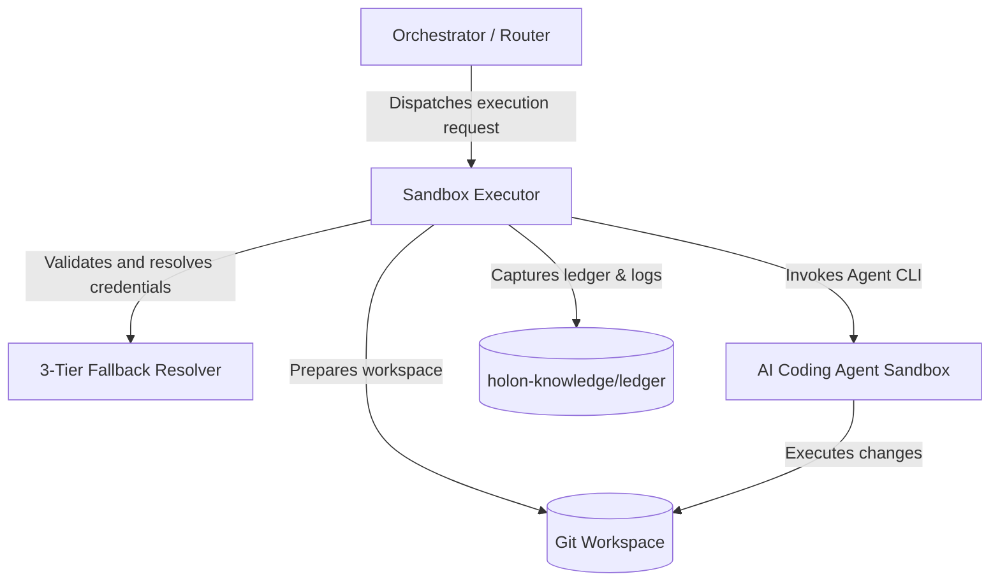
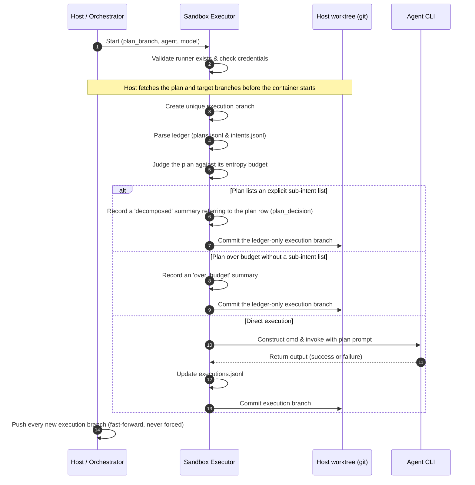

# Execution Architecture Specification

The **Sandbox Executor** is a critical component in the Holon Agentic Coder ecosystem. It is responsible for checking
out a plan branch, preparing the sandbox environment, invoking the target AI coding agent, capturing the execution logs
and results, writing records to the execution ledger, and committing and pushing the modifications back to the remote
repository.

---

## High-Level Architecture

The Sandbox Executor operates as a bridging layer between the orchestrating system and the containerized coding agent.



- **Orchestrator**: Dispatches intent and execution branches to the sandbox runner.
- **Sandbox Executor**: Runs within the execution sandbox (or on the host in local mode) to manage git state, agent
  configuration, safety checks, and ledger updates.
- **Sandboxes (Process / Container / VM)**: Provide environment isolation. In containerized environments, the executor
  runs inside specialized agent container images (e.g., `holon/agent-<agent_id>`).

---

## Execution Lifecycle Flow

The execution process follows a strict sequential lifecycle:



### 1. Runner Validation

The executor verifies that the chosen agent is registered in the runner registry and performs initial credential
validation under the **3-Tier Fallback Contract**.

### 2. Workspace Preparation

Depending on the environment configuration:

- **Host worktree**: The container works in place on the flow's host-provisioned `flow-<slug>` worktree, bind-mounted at
  the sandbox workspace path (`HOLON_TARGET_WORKTREE`). The executor never clones, fetches, resets or pushes.
- **Host-side fetch and push**: Before the container starts, the host fetches the plan branch and the target branch.
  After it returns, the host pushes every new execution branch, including a failed one so a resume can find it. If the
  host push fails, the commits stay on the host's local branch and the error names the operation, branch and remote. No
  repository URL variable exists.

### 3. Execution Branch Creation

A unique, tracking-compatible execution branch is spawned off the plan branch:

```
{plan_branch_prefix}/E-{timestamp}-{sanitized_agent}-{sanitized_model}/_
```

### 4. Ledger & Plan Parsing

The executor parses the local ledger files `holon-knowledge/ledger/plans.jsonl` and
`holon-knowledge/ledger/intents.jsonl` to locate active intent configurations.

### 5. Entropy Budget and Decomposition Evaluation

Before invoking the agent, `should_decompose(plan_data, plan_content, intent_data)` judges the plan against the same
entropy budget the planner showed the agent and persisted on the plan row, resolved by `budgets.resolve_entropy_budget`
(plan row, then intent row, then `DEFAULT_ENTROPY_BUDGET`; see [Turn and Stage Budgets](../budgets.md#entropy-budget)).
It returns one of three outcomes:

- **`execute`**: the plan fits its budget and lists no sub-intent list; the agent runs as described below.
- **`decomposed`**: the plan contains a level-2 or level-3 heading reading "Sub-intent list" (hyphens, underscores,
  spacing and case are ignored, so the older plural heading still works) followed by bullet or numbered items. Each
  top-level item becomes `{slug, description, goal}` (slug and goal from the item text only), whatever the plan entropy;
  indented nested bullets are appended to their parent item's description and never become items, and placeholder items
  are skipped: an item is a placeholder when, stripped of wrapping brackets, quotes and emphasis markers and trailing
  punctuation and lower-cased, its first whole word is `none`, `n/a`, `na`, `nil`, `no` or `not`, whatever follows, so
  `None (plan fits the budget)` and `No sub-intents needed` are skipped while `Nonetheless ...` and `Normalise ...` are
  real items (the planner template requires every real item to start with an imperative verb). Per-step sub‑intent
  recommendation bullets are never read as a list.
- **`over_budget`**: the plan entropy exceeds the budget and the plan lists no sub-intent list.

The executor never invents child work and never writes `intents.jsonl` rows. For both non-execute outcomes it skips the
agent, records one `executions.jsonl` summary (`status: "decomposed"` with a `plan_decision` reference to the plan row's
list, never a copy, or `status: "over_budget"` with `entropy`, `entropy_budget` and a message) and commits only that
ledger to the execution branch. The host then pushes the branch after the container returns; the container never pushes.
Exit codes: `over_budget` exits 3 (`OVER_BUDGET_EXIT_CODE`) only when its row is committed; every other outcome exits 1.
`decomposed` exits 0 when recording and committing its row raise no error, which includes a run where nothing was
staged; any failure while recording or committing its row exits 1. Whether it exits 3 or 1, a direct `holon execute` of
an `over_budget` plan fails, while the flow reads the recorded row and decides what happens next: each child intent is
created through the normal Stage 1 intent creator and run through the full pipeline (unless the plan's intent is already
at `budgets.MAX_SUB_INTENT_DEPTH`, in which case Stage 3 fails and refuses to recurse further), or the plan is sent back
to Stage 2 (see [Git Flow](../git_flow.md#flow-equivalence-guarantee)).

### 6. Agent Invocation

A prompt payload file and an intent JSON file are generated in `/tmp`. The agent's CLI wrapper is executed under the
turn supervisor (turn, stall and execute-stage budgets; see [Turn and Stage Budgets](../budgets.md)), forwarding the
full prompt, which ends with the incremental execution-notes write protocol. The outcome is decided from the first
(implementation) turn: exit code 0 is success; a non-zero exit is treated as informational only when the runner reported
a structured truncation of its final message (`stopReason: length`) and the execution notes are complete, so a generic
exit 1 (auth or API errors) is always a failure. A budget breach of the implementation turn is a failure even if a
notes-only resume made the notes usable, while a breach confined to the notes-only follow-up keeps the code changes.

### 7. Result Recording & Ledger Updates

Execution state and verdicts are recorded exclusively in `holon-knowledge/ledger/executions.jsonl`, which serves as the
single authoritative append-only source of truth for execution telemetry. The executor itself never generates markdown
files under `executions/`. The execution agent is asked to keep incremental notes at `executions/{execution_id}.md`;
they are validated report-only, committed with the agent's other changes, and their validity is recorded in the ledger
summary row (`execution_notes_valid`). See
[Running Execution via Docker](../sandbox/execute_plan.md#incremental-execution-notes).

### 8. Git Commit & Push

All modified files and ledgers are added and committed in the mounted worktree under the unique execution branch. The
container does not push: the host pushes every new execution branch after the container returns, including a failed one
so a resume can find it. If that push fails, the commits stay on the host's local branch.

Before the final commit the executor merges the fetched target branch. A conflict confined to ledgers is reconciled by
append. A conflict in any other file (for example a file that a merged pull request deleted) aborts the merge and keeps
the executor's own commits on the execution branch, a fast-forward of the plan branch with no merge commit. The executor
records a superseding `sync_conflict` row naming `conflicted_paths` and exits `0`. The execute stage treats that row as
resumable: it sets `execution_branch` in the context and checkpoint, so the flow continues from the review stage or
hands the conflict to a resolver. Any other sync failure still records a failure and does not publish the branch.

---

## Safety & Security Policies

### Path-Traversal Protection (`_check_forbidden_root`)

To prevent the sandbox executor from accidentally or maliciously deleting or writing to critical host or container paths
(like `/`, `/usr`, etc.) during cleanup operations, a strict path-traversal safelist is enforced.

- **Operation Check**: Any cleanup operation targeting a directory (such as workspace clearing) must pass the
  `_check_forbidden_root` validation.
- **Allowed Parent Directories (`ALLOWED_PARENTS`)**:
  - `/home`
  - `/Users`
  - `/tmp`
  - `/var/tmp`
  - `/private/var/folders`
  - `/var/folders`
  - `~/.holon-sandbox`
  - `~/.holon`
  - The system-level temporary directory (`tempfile.gettempdir()`)
- **Allowed Exact Paths (`ALLOWED_EXACT`)**:
  - `/workspace`
  - `/repo`
- **Validation Logic**:
  1. The target path is fully resolved to absolute and real (canonicalized) paths via `os.path.abspath` and
     `os.path.realpath`.
  2. If the path resolves exactly to the system root `/`, execution is aborted with a `RuntimeError`.
  3. The path must either match an item in the allowed exact paths or reside strictly nested within one of the allowed
     parent paths (evaluated with a trailing slash check to prevent partial name matches, e.g., `/tmp-unsafe` matching
     `/tmp`).

### Secret Redaction Mechanism

To keep passwords, OAuth tokens, and API credentials from leaking into stdout, stderr, execution ledgers, or printed git
outputs:

- **Regex Redaction (`redact_text`)**: Interprets strings and dynamically masks:
  - HTTP basic authentication credentials inside URLs (`https://token@github.com...`).
  - Sensitive URL parameters (e.g. `?token=...`, `?api_key=...`, `?code=...`).
  - Common configuration variables matching keys like `token`, `secret`, `password`, `api_key`, `auth`, `bearer`, `pat`,
    `private_key` paired with separators `:` or `=`.
- **Command Line Argument Masking (`redact_args`)**:
  - Arguments immediately following known secret flags are redacted.
  - **Secret Flags**: `--password`, `--passwd`, `--auth`, or any flag ending in `-token`, `_token`, `-secret`,
    `_secret`, `-key`, or `_key`.
  - _Limitation_: To avoid over-masking legitimate flags that immediately follow a secret flag, if the secret value
    itself starts with `-` (resembling a CLI flag), it will **not** be masked.
- **ReDoS Prevention**: Inputs to `redact_text` exceeding 100,000 characters are safely truncated from the middle before
  regex evaluation.

### Resume Salvage of Interrupted Work

A killed container or a usage limit leaves the executor's edits uncommitted in the mounted worktree, and the executor
refuses a dirty mount. On a Stage 3 resume the host therefore runs `flow/partial_salvage.py` before dispatch. When the
worktree is on a failed `E-...` execution branch of the plan and holds tracked edits, deletions or non-ignored untracked
files, the host commits them as `execute: <execution_id> partial work (interrupted) for plan <plan_branch>`, pushes the
branch and appends one superseding `failure` row carrying `partial_head`. The existing partial-work lookup then finds
the branch and the executor continues from it. The three ledgers and the execution notes file are engine-owned and never
committed. If only those are dirty, or the worktree is clean, nothing happens. A dirty worktree on any other branch is
refused with a message naming it. The executor still re-runs its checks, the review loop sees the final diff, and
merging stays with the human maintainer.

### Workspace Retention Policy

The flow's `flow-<slug>` worktree lives on the host, so edits, commits and logs survive a container crash. The container
neither clears nor cleans it.

### Commit Attribution

No commit carries an attribution trailer such as `Co-Authored-By: Claude <model> <noreply@anthropic.com>`. Two measures
enforce this in Stage 3:

- `ClaudeAgentRunner.build_cmd` always passes `--settings` with `includeCoAuthoredBy` set to `false` and an empty
  `attribution` (`commit` and `pr`), merged into any `HOLON_AGENT_SETTINGS` value (inline JSON or a file path, which is
  read and never written). The user's own settings files and the permission flags are untouched.
- After the execution commit, `attribution_check.py` scans the non-merge commits of `plan tip..HEAD` with `git log` and
  prints a report for any trailer. It warns by default; set `HOLON_ATTRIBUTION_STRICT=1` to refuse publishing instead.

History is never rewritten, so only new trailers are prevented; a trailer written by a manual `git commit` is detected,
not prevented.
