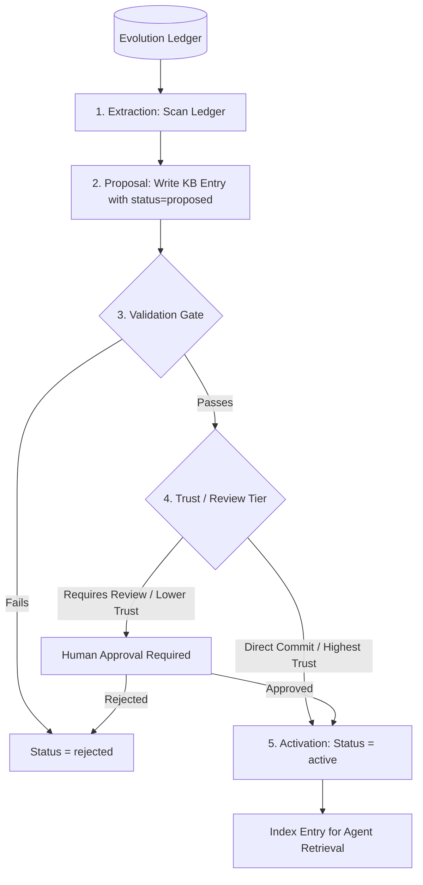

# kb_schema.md

This document defines the **Knowledge Base (KB)** schema for Holon. The KB is a **curated, read/write store** that
captures reusable knowledge extracted from the ledger to accelerate future planning, improve estimators, and avoid known
failure modes.

The KB enables:

- **faster planning** (reuse proven tactics instead of re-discovering them)
- **better predictions** (learn from historical calibration data)
- **failure avoidance** (remember what didn't work and why)
- **estimator evolution** (propose and validate better metric estimators)

---

## Core principles

### 1) Curated, not raw

- KB entries are **extracted and refined** from ledger events.
- Not every ledger event becomes a KB entry.
- KB entries are **human-readable and actionable**.

### 2) Versioned and traceable

- Every KB entry has a version.
- Every KB entry traces back to ledger evidence (intent IDs, execution results).
- Old versions are retained (never deleted).

### 3) Write-gated

- KB writes require **validation**:
  - Evidence from ledger (minimum N successful executions).
  - Calibration improvement (for estimator proposals).
  - Human approval (for governance changes).
- Prevents KB poisoning from bad agent proposals.

### 4) Retrieval-optimised

- KB is indexed for fast retrieval during planning.
- Queries: "similar intents", "tactics for goal X", "failure modes in module Y".

### 5) Separate from ledger

- **Ledger** = append-only, immutable, forensic.
- **KB** = curated, versioned, actionable.
- KB is derived from ledger, but not a replacement.

---

## Storage format

### Recommended format: Structured JSON files + index

```
holon-knowledge/kb/
├── patterns/
│   ├── pattern_001.json
│   ├── pattern_002.json
│   └── index.json
├── tactics/
│   ├── tactic_001.json
│   ├── tactic_002.json
│   └── index.json
├── failure_modes/
│   ├── failure_001.json
│   ├── failure_002.json
│   └── index.json
├── estimators/
│   ├── p_success_v1.json
│   ├── p_success_v2.json
│   ├── entropy_v1.json
│   ├── learning_value_v1.json
│   └── index.json
├── routing_heuristics/
│   ├── routing_v1.json
│   └── index.json
├── modules/
│   ├── module_001.json  # reusable code modules
│   └── index.json
└── meta.json  # KB-level metadata
```

**Why structured files?**

- Git-friendly (diffs, merges, history).
- Human-readable (easy to review).
- Queryable (via index or simple file search).

---

## Common envelope (all KB entries)

Every KB entry MUST contain:

- `kb_id` (string, unique)  
  Example: `"KB-pattern-001"`
- `kb_type` (string)  
  Example: `"pattern"`, `"tactic"`, `"failure_mode"`, `"estimator"`, `"routing_heuristic"`, `"module"`
- `version` (string)  
  Example: `"1.0"`, `"2.1"`
- `created_ts` (string, ISO-8601 UTC)
- `updated_ts` (string, ISO-8601 UTC)
- `created_by` (string)  
  Example: `"agent-curator-03"` or `"human@example.com"`
- `status` (string)  
  Example: `"active"`, `"deprecated"`, `"proposed"`, `"rejected"`
- `evidence` (object)
  - `ledger_refs` (array of strings) — intent IDs or ledger event seqs
  - `success_count` (integer)
  - `failure_count` (integer)
  - `calibration_improvement` (number, optional)
- `tags` (array of strings)  
  Example: `["metrics", "bootstrap", "p_success"]`
- `human_approved` (boolean)

**Minimal envelope example**

```json
{
  "kb_id": "KB-pattern-001",
  "kb_type": "pattern",
  "version": "1.0",
  "created_ts": "2026-02-10T05:30:00Z",
  "updated_ts": "2026-02-10T05:30:00Z",
  "created_by": "agent-curator-03",
  "status": "active",
  "evidence": {
    "ledger_refs": ["I-1771890300-bootstrap-p-success", "I-1771890503-implement-impact"],
    "success_count": 5,
    "failure_count": 0
  },
  "tags": ["git", "rebase", "conflict-resolution"],
  "human_approved": true,
  "payload": {}
}
```

---

## KB entry types

### 1) Pattern

**Definition:** A proven approach or structure that succeeded multiple times.

**Use case:** Planning agents retrieve patterns to guide plan generation.

**Schema:**

```json
{
  "kb_id": "KB-pattern-001",
  "kb_type": "pattern",
  "version": "1.0",
  "created_ts": "2026-02-10T05:30:00Z",
  "updated_ts": "2026-02-10T05:30:00Z",
  "created_by": "agent-curator-03",
  "status": "active",
  "evidence": {
    "ledger_refs": [
      "I-1771890300-bootstrap-p-success",
      "I-1771890503-implement-impact",
      "I-1771891052-implement-learning-value-estimator"
    ],
    "success_count": 8,
    "failure_count": 1,
    "avg_p_success": 0.92,
    "avg_entropy": 15.3
  },
  "tags": ["metrics", "estimator", "bootstrap"],
  "human_approved": true,
  "payload": {
    "name": "Weighted Feature Sum for P(success)",
    "description": "Estimate P(success) as a weighted sum of plan features: coverage, dependency confidence, novelty penalty, depth penalty.",
    "applicability": {
      "intent_types": ["implement_estimator", "implement_calculator"],
      "complexity_range": [0.3, 0.7],
      "entropy_range": [5, 30]
    },
    "structure": {
      "steps": [
        "Identify plan features (coverage, dependencies, novelty, depth)",
        "Assign weights based on historical calibration",
        "Compute weighted sum",
        "Clamp to [0, 1]"
      ],
      "sub_intents": ["Extract plan features", "Compute weighted score", "Validate range"]
    },
    "known_pitfalls": ["Weights may need tuning per domain", "Novelty penalty can be too harsh for exploratory work"],
    "related_patterns": ["KB-pattern-002", "KB-pattern-005"]
  }
}
```

---

### 2) Tactic

**Definition:** A specific, actionable technique or code snippet that solves a narrow problem.

**Use case:** Execution agents retrieve tactics to implement specific steps.

**Schema:**

```json
{
  "kb_id": "KB-tactic-001",
  "kb_type": "tactic",
  "version": "1.0",
  "created_ts": "2026-02-10T06:15:00Z",
  "updated_ts": "2026-02-10T06:15:00Z",
  "created_by": "agent-executor-12",
  "status": "active",
  "evidence": {
    "ledger_refs": ["I-1771890602-add-logging", "I-1771891071-implement-routing-roi"],
    "success_count": 12,
    "failure_count": 0
  },
  "tags": ["git", "rebase", "automation"],
  "human_approved": true,
  "payload": {
    "name": "Safe Git Rebase with Conflict Detection",
    "description": "Rebase from parent branch with automatic conflict detection and rollback on failure.",
    "language": "bash",
    "code": "#!/bin/bash\nset -e\nPARENT_BRANCH=$1\ngit fetch origin\nif git rebase origin/$PARENT_BRANCH; then\n  echo 'Rebase successful'\n  exit 0\nelse\n  echo 'Rebase conflict detected'\n  git rebase --abort\n  exit 1\nfi",
    "usage": {
      "when": "Before execution or before merge",
      "inputs": ["parent_branch"],
      "outputs": ["exit_code", "conflict_files"],
      "side_effects": ["modifies git history (if successful)", "aborts on conflict"]
    },
    "known_limitations": ["Does not resolve conflicts automatically", "Requires clean working tree"],
    "related_tactics": ["KB-tactic-002", "KB-tactic-008"]
  }
}
```

---

### 3) Failure Mode

**Definition:** A known way that intents fail, with diagnostic signals and mitigations.

**Use case:** Planning agents avoid known failure modes; execution agents detect and recover.

**Schema:**

```json
{
  "kb_id": "KB-failure-001",
  "kb_type": "failure_mode",
  "version": "1.0",
  "created_ts": "2026-02-10T07:00:00Z",
  "updated_ts": "2026-02-10T07:00:00Z",
  "created_by": "agent-curator-05",
  "status": "active",
  "evidence": {
    "ledger_refs": ["I-1771890504-implement-ev", "I-1771890601-add-caching", "I-1771891062-tune-entropy-weights"],
    "success_count": 0,
    "failure_count": 7
  },
  "tags": ["rebase", "conflict", "concurrent-work"],
  "human_approved": true,
  "payload": {
    "name": "Rebase Conflict from Concurrent File Edits",
    "description": "Two sub-intents modify the same file concurrently, causing rebase conflicts when merging.",
    "symptoms": [
      "git rebase fails with conflict",
      "conflict_files overlap with other active intents",
      "entropy spike (measured > predicted by >50%)"
    ],
    "root_causes": [
      "Insufficient work decomposition (sub-intents too coarse)",
      "No coordination between concurrent sub-intents",
      "High file coupling"
    ],
    "mitigations": [
      {
        "strategy": "Sequential merges",
        "description": "Merge sub-intents one at a time, forcing rebase after each merge.",
        "cost": "Slower (serialised work)",
        "effectiveness": 0.95
      },
      {
        "strategy": "Finer-grained decomposition",
        "description": "Split intents to minimise file overlap.",
        "cost": "More planning overhead",
        "effectiveness": 0.85
      },
      {
        "strategy": "Conflict-aware entropy estimation",
        "description": "Increase predicted entropy for intents with high file overlap.",
        "cost": "Better routing (deeper models for high-conflict work)",
        "effectiveness": 0.7
      }
    ],
    "detection_heuristic": {
      "condition": "rebase_conflicts > 0 AND concurrent_work_overlap > 0.5",
      "confidence": 0.9
    },
    "related_failures": ["KB-failure-003", "KB-failure-007"]
  }
}
```

---

### 4) Estimator

**Definition:** A versioned implementation of a metric estimator (P(success), ΔS, Impact, LearningValue, etc.).

**Use case:** System uses active estimator version; agents propose improvements.

**Schema:**

```json
{
  "kb_id": "KB-estimator-p_success-v2",
  "kb_type": "estimator",
  "version": "2.0",
  "created_ts": "2026-02-12T10:00:00Z",
  "updated_ts": "2026-02-12T10:00:00Z",
  "created_by": "agent-researcher-08",
  "status": "proposed",
  "evidence": {
    "ledger_refs": ["I-1771891101-backtest-p-success-estimator"],
    "success_count": 0,
    "failure_count": 0,
    "calibration_improvement": 0.12,
    "backtest_window": "2026-02-01 to 2026-02-10",
    "backtest_sample_size": 47
  },
  "tags": ["p_success", "estimator", "improvement"],
  "human_approved": false,
  "payload": {
    "metric_name": "p_success",
    "replaces_version": "p_success_v1",
    "description": "Improved P(success) estimator using historical calibration data to adjust feature weights dynamically.",
    "implementation": {
      "language": "python",
      "code": "def estimate_p_success_v2(plan, historical_calibration):\n    base_score = 0.5\n    weights = compute_adaptive_weights(historical_calibration)\n    score = base_score\n    score += weights['coverage'] * plan.coverage\n    score += weights['dependency_confidence'] * plan.dependency_confidence\n    score -= weights['novelty'] * plan.novelty\n    score -= weights['depth'] * max(0, plan.depth - 3)\n    return max(0.0, min(1.0, score))",
      "dependencies": ["historical_calibration data from ledger"]
    },
    "calibration_comparison": {
      "v1_mean_error": 0.28,
      "v2_mean_error": 0.16,
      "improvement": 0.12,
      "test_set_size": 47
    },
    "explainability": {
      "method": "Feature weights are derived from historical calibration, making them auditable.",
      "interpretability_score": 0.85
    },
    "computational_cost": {
      "relative_to_v1": 1.3,
      "acceptable": true
    },
    "approval_requirements": {
      "human_review": true,
      "backtest_threshold": 0.1,
      "min_sample_size": 30
    },
    "related_estimators": ["KB-estimator-p_success-v1", "KB-estimator-entropy-v2"]
  }
}
```

---

### 5) Routing Heuristic

**Definition:** A policy for selecting model tiers based on task characteristics.

**Use case:** Router uses active heuristic to assign models; agents propose improvements.

**Schema:**

```json
{
  "kb_id": "KB-routing-v1",
  "kb_type": "routing_heuristic",
  "version": "1.0",
  "created_ts": "2026-02-10T08:00:00Z",
  "updated_ts": "2026-02-10T08:00:00Z",
  "created_by": "human@example.com",
  "status": "active",
  "evidence": {
    "ledger_refs": [],
    "success_count": 0,
    "failure_count": 0
  },
  "tags": ["routing", "model-selection", "bootstrap"],
  "human_approved": true,
  "payload": {
    "name": "Entropy-Based Model Routing",
    "description": "Route to deeper models for high-entropy, high-novelty tasks; route to fast models for low-entropy tasks.",
    "rules": [
      {
        "condition": "predicted_entropy > 30 OR novelty > 0.7",
        "action": "route_to_tier('deep')",
        "reason": "High-entropy or unfamiliar work requires careful reasoning"
      },
      {
        "condition": "predicted_entropy < 10 AND novelty < 0.3",
        "action": "route_to_tier('flash')",
        "reason": "Low-entropy, familiar work can use fast models"
      },
      {
        "condition": "default",
        "action": "route_to_tier('medium')",
        "reason": "Moderate complexity"
      }
    ],
    "model_tiers": {
      "flash": ["gemini-3.6-flash", "claude-haiku-4.6"],
      "medium": ["gemini-3.1-pro", "claude-sonnet-4.6"],
      "deep": ["gemini-3.6-flash-thinking", "claude-opus-4.6"]
    },
    "evaluation_metric": "routing_roi",
    "roi_formula": "(actual_impact - actual_cost) / model_cost",
    "related_heuristics": []
  }
}
```

---

### 6) Module

**Definition:** A reusable code module or library extracted from successful executions.

**Use case:** Execution agents import modules instead of re-implementing common functionality.

**Schema:**

```json
{
  "kb_id": "KB-module-001",
  "kb_type": "module",
  "version": "1.0",
  "created_ts": "2026-02-10T09:00:00Z",
  "updated_ts": "2026-02-10T09:00:00Z",
  "created_by": "agent-extractor-02",
  "status": "active",
  "evidence": {
    "ledger_refs": ["I-1771890300-bootstrap-p-success", "I-1771890502-implement-entropy"],
    "success_count": 6,
    "failure_count": 0
  },
  "tags": ["metrics", "calibration", "reusable"],
  "human_approved": true,
  "payload": {
    "name": "Calibration Tracker",
    "description": "Tracks prediction accuracy over time for a given agent/model.",
    "language": "python",
    "module_path": "holon/metrics/calibration.py",
    "exports": ["CalibrationTracker", "compute_calibration_error", "get_agent_calibration"],
    "usage_example": "from holon.metrics.calibration import CalibrationTracker\ntracker = CalibrationTracker(agent_id='agent-01')\ntracker.record(predicted=0.8, actual=1.0)\nerror = tracker.get_mean_error()",
    "dependencies": ["ledger.reader"],
    "test_coverage": 0.95,
    "related_modules": ["KB-module-002"]
  }
}
```

---

## Write-gated curation: Config-Driven Schemas

KB entries are validated against schemas defined in `holon-config/schemas/kb.json`. This ensures that all proposed and
active entries conform to the system’s structural and evidential requirements.

### KB write rules (curation gates)

A curator or system component must:

- Load the relevant schema from `holon-config/schemas/kb.json`.
- Enforce evidence thresholds (e.g., minimum successful executions).
- Validate calibration improvements (for estimator proposals).
- Check human approval status (for governance changes).
- Prevent KB poisoning by rejecting non-conforming entries.

---

## KB retrieval patterns

### Query 1: Similar intents

```python
def find_similar_intents(goal_text, constraints):
    # Retrieve patterns with similar tags, complexity, entropy
    patterns = kb.query(
        kb_type="pattern",
        tags=extract_tags(goal_text),
        complexity_range=constraints.complexity_range,
        entropy_range=constraints.entropy_range,
    )
    return patterns
```

### Query 2: Tactics for a step

```python
def find_tactics(step_description, language):
    tactics = kb.query(kb_type="tactic", tags=extract_tags(step_description), language=language, status="active")
    return tactics
```

### Query 3: Failure modes for a module

```python
def find_failure_modes(module_path):
    failures = kb.query(kb_type="failure_mode", tags=[module_path], status="active")
    return failures
```

### Query 4: Active estimator version

```python
def get_active_estimator(metric_name):
    estimator = kb.query_one(kb_type="estimator", metric_name=metric_name, status="active")
    return estimator
```

---

## KB index structure

Each KB subdirectory has an `index.json` for fast lookup:

```json
{
  "index_version": "1.0",
  "updated_ts": "2026-02-10T10:00:00Z",
  "entries": [
    {
      "kb_id": "KB-pattern-001",
      "file": "pattern_001.json",
      "tags": ["metrics", "estimator", "bootstrap"],
      "status": "active",
      "created_ts": "2026-02-10T05:30:00Z"
    },
    {
      "kb_id": "KB-pattern-002",
      "file": "pattern_002.json",
      "tags": ["git", "rebase", "conflict"],
      "status": "active",
      "created_ts": "2026-02-10T06:00:00Z"
    }
  ],
  "tag_index": {
    "metrics": ["KB-pattern-001"],
    "git": ["KB-pattern-002"],
    "rebase": ["KB-pattern-002"]
  }
}
```

---

## KB maintenance and evolution

### Curation process

The curation process transforms raw history in the Evolution Ledger into structured, actionable intelligence in the
Knowledge Base. Curation is run periodically by a specialized background **Curator Agent** or triggered manually by a
developer.



#### 1. Extraction (Triggers & Scans)

The Curator Agent scans the Ledger looking for the following triggers:

- **Pattern Learning:** Identifies $N \ge 3$ consecutive successful intents that modify similar components, extracting
  their plan graphs as reusable templates.
- **Failure Mode Discovery:** Detects repeating failure patterns (e.g., rebase conflicts on specific files, common test
  suite timeouts) to create mitigation rules.
- **Calibration Drift:** Monitors where predicted $P(success)$ or predicted entropy deviates significantly from actual
  outcomes, signaling that estimators need updating.

#### 2. Proposal

The Curator Agent generates a structured KB entry (schema matching its type, e.g., `pattern` or `failure_mode`) with
`status = "proposed"`. It must link to the specific ledger sequence IDs (`evidence`) for auditability.

#### 3. Validation Gate

Automated checks are run on the proposal:

- **JSON Schema Validation:** Ensures the entry conforms to the schema definitions in `knowledgebase_schema.md`.
- **Evidence Verification:** Verifies the referenced ledger entries exist and support the claim.
- **Backtesting (Estimators only):** If proposing a modification to a planning estimator or weight, the curator runs a
  simulation against the last 50 ledger executions to verify it reduces average calibration error.

#### 4. Review & Approval Tiers

Curation capability depends on the agent's Trust Level:

- **Baseline / Medium Agents:** Can only submit proposals that _must_ be approved by a human.
- **High / Highest Agents:** Can commit standard code patterns and failure mode entries directly (`active`). However,
  modifications to estimators, configuration weights, or core guidelines always require human approval.

#### 5. Activation & Feedback Loop

Once approved/validated:

- The entry's status becomes `active`.
- The orchestrator indexes the new entry for semantic search.
- Future planning agents are structurally required to query the active KB at the beginning of their planning phase to
  seed plan graphs and adjust metrics predictions.

---

### Deprecation process

1. **Trigger:** New version supersedes old version, or pattern no longer effective.
2. **Status change:** Old entry status = `deprecated`.
3. **Retention:** Old entry remains in KB (for audit trail).
4. **Retrieval:** Queries exclude deprecated entries by default (unless explicitly requested).

### Conflict resolution

1. **Detection:** Two agents propose conflicting entries (same kb_id or overlapping scope).
2. **Recording:** Both recorded with status = `proposed`.
3. **Evaluation:** Compare evidence, calibration, ROI.
4. **Decision:** Human selects winner (or rejects both).
5. **Outcome:** Winner status = `active`, loser status = `rejected`.

---

## KB vs Ledger: When to use which?

| Use case                       | Ledger | KB  |
| ------------------------------ | ------ | --- |
| Record what happened           | ✓      |     |
| Audit trail                    | ✓      |     |
| Calibration measurement        | ✓      |     |
| Retrieve proven patterns       |        | ✓   |
| Avoid known failures           |        | ✓   |
| Propose estimator improvements |        | ✓   |
| Query "similar intents"        |        | ✓   |
| Immutable history              | ✓      |     |
| Curated, actionable knowledge  |        | ✓   |

**Rule of thumb:**

- **Ledger** = "what happened" (forensic, immutable).
- **KB** = "what we learnt" (curated, actionable).

---

## Related documents

- [`ledger_schema.md`](ledger_schema.md) — how KB entries trace back to ledger evidence
- [`metrics.md`](metrics.md) — estimator definitions that live in KB
- [`architecture.md`](architecture.md) — how KB fits into the system
- [`git_flow.md`](git_flow.md) — how KB patterns guide git discipline
