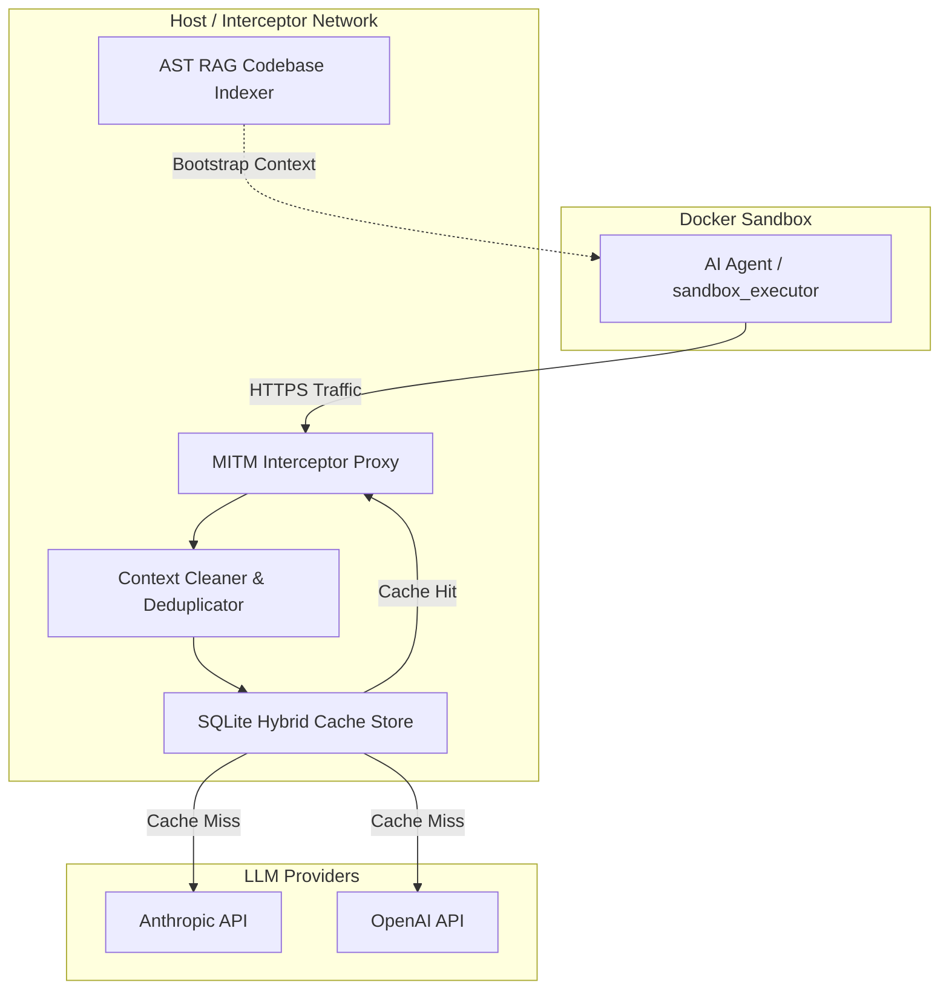

# AI Agent Token Reduction System Architecture

This document describes the design, data flow, and implementation details of the multi-tiered token reduction
architecture.

---

## 🗺️ System Architecture Overview

The system operates as an interception layer between the containerized AI agent running inside the sandbox and the
external LLM API endpoints.

---

## 🔍 Detail by Phase

### Phase 1: MITM Interceptor & SSL/TLS Trust

- **Root CA Generation**: Generates a self-signed Root Certificate Authority (`holon-root-ca.crt`).
- **Trust Injection**: The host CLI automatically mounts the generated Root CA into `/usr/local/share/ca-certificates/`
  inside the target container and configures:
  - `NODE_EXTRA_CA_CERTS` (Node.js/Prettier/TypeScript tools)
  - `REQUESTS_CA_BUNDLE` & `SSL_CERT_FILE` (Python library requests)
  - `CURL_CA_BUNDLE` (cURL command line calls)
- **Proxy Interception**: Outbound requests are routed via `mitmproxy` using the addon holon-coherence ships in its
  proxy image. holon-coherence owns token reduction; this repository's launcher only starts that image as a sidecar,
  keeps the host Root CA valid (`launcher/root_ca.py`) and probes proxy readiness (`launcher/proxy_readiness.py`).

---

### Phases 2-4: implemented by holon-coherence

Everything past the interception point runs inside the holon-coherence proxy image, not in this repository; see the
[holon-coherence](../../holon-coherence) submodule for the code and its own documentation:

- **Phase 2, payload cleaning** (`holon_coherence/payload_cleaner.py`): deduplicates repeated large tool results,
  injects Anthropic `cache_control` breakpoints and summarises long histories.
- **Phase 3, hybrid cache** (`holon_coherence/hybrid_cache.py`): normalises request keys, then serves exact and
  similarity-matched cache hits from the proxy without an upstream call.
- **Phase 4, codebase RAG and Ringer delegation** (`holon_coherence/rag_indexer.py`,
  `holon_coherence/ringer_orchestrator.py`): symbol-level codebase indexing and Architect/Executor task delegation.
