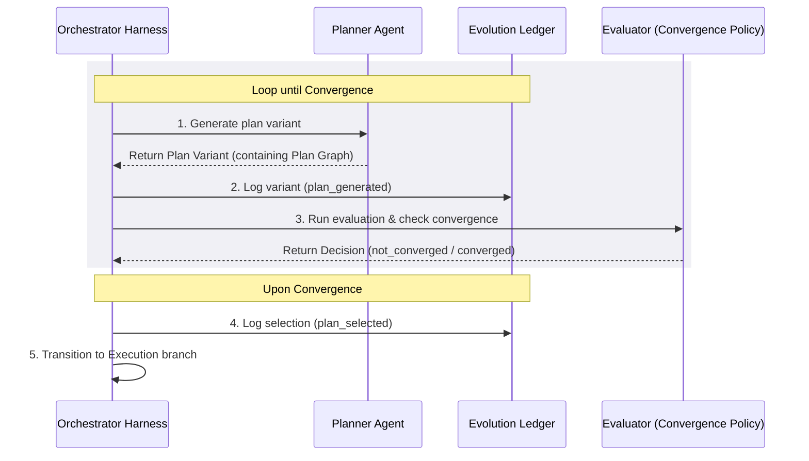

### planning_and_evaluation.md

This document specifies the Planning and Evaluation subsystem: how plans are generated, scored, compared, and converged.
It defines the planners' contracts, evaluation metrics, convergence/termination policies, failure handling, and how the
results integrate with the ledger and git flow.

---

### Overview

Planning is the process of converting an Intent (goal + constraints) into one or more actionable Plan Variants.
Evaluation ranks these variants and decides when to stop planning and move to execution. Planning is competitive:
multiple hypotheses (variants) are created, scored, and compared using stable metrics. All planning activity is logged
to the ledger and materialised as plan artefacts (plan graph + metadata + branch).

Key goals:

- Produce a set of candidate plans with predicted metrics
- Evaluate plans consistently using Expected Value (EV) and entropy-aware penalties
- Stop planning when convergence criteria are met
- Record predictions and outcomes for calibration and learning

---

#### Planning lifecycle (high-level)

1. Intent created (root/sub/reactive)
2. Planner agent generates N initial Plan Variants
3. Evaluator ranks variants and checks convergence
4. If not converged, Planner generates additional variants (or decomposes into sub-intents)
5. When converged, Evaluator selects winner and Meta-Agent schedules execution
6. Execution runs in sandbox; actual metrics are measured and written to ledger
7. Calibration updates and KB proposals may follow

---

### Plan Variant Generation

#### Plan Variant vs. Plan Graph

To prevent boundary ambiguity, the system distinguishes these concepts:

- **Plan Graph:** The logical dependency graph of the plan. It specifies the step nodes, sequence constraints, execution
  actions, and any child sub-intents. It is purely structural.
- **Plan Variant:** A competitive candidate proposal wrapped in an evaluation envelope. It contains a specific
  `plan_graph` along with its prediction metrics ($P(success)$, $\Delta S_{intent}$, $EV$), cost estimates, routing
  decisions, and metadata (creator agent, generation model, timestamps).

For any single intent, multiple competing **Plan Variants** (each housing a different **Plan Graph**) are generated and
evaluated.

#### Plan Variant (artifact)

Each plan variant is a first-class artefact with:

- `plan_id` (e.g., `P-{intent_id}-v{variant}-{model_tier}`)
- `plan_graph` (steps, sub-intents, dependencies)
- `predicted_metrics` (p_success, entropy, impact, cost, learning_value, ev)
- `model_id` and `routing_reason`
- `created_by` (agent_id)
- `created_at`

Planner responsibilities:

- Generate diverse, focused variants (different approaches / trade-offs)
- Produce structured plan graphs (explicit steps + sub-intents)
- Attach predicted metrics and confidence intervals
- Propose decomposition into sub-intents when appropriate, through an explicit `## Sub-intent list` section (one bullet
  per concrete child intent); a plan above its entropy budget without that section is re-planned a bounded number of
  times and then fails (see [Turn and Stage Budgets](budgets.md#entropy-budget))

#### Variant diversity guidance

- At least one low-risk (low entropy) conservative plan
- At least one exploration or spike plan optimised for learning_value (even if p_success is lower), if
  exploration/entropy budget allows
- At least one short-path / minimal-change plan
- Use KB to seed templates from proven patterns

---

### Metrics & Estimators

All planners and evaluators must use the canonical metric names and estimator interfaces stored in the KB.

#### Canonical metrics

- `P(success)` or `p_success`: predicted probability the plan will meet the intent goal
- `ΔS` or `entropy`: predicted intent-local entropy increase (see core_concepts)
- `Impact`: estimated positive benefit if successful (domain units)
- `Cost`: resource/time/human cost estimate
- `LearningValue` or `learning_value`: expected epistemic gain (0–10), independent of success
- `EV`: Expected Value used for ranking

Use these variables in formulas below.

#### Expected Value (conceptual)

$$EV = P(success)\cdot Impact + \mu\cdot LearningValue - \lambda \cdot \Delta S_{intent} - Cost$$

- $\lambda$ is an entropy penalty hyperparameter (system-level constant).
- $\mu$ is a learning value coefficient (system-level constant)
- All terms must use consistent units or be normalised by agreed scales.

#### Bootstrap P(success) estimator (recommended initial form)

Planners may use a weighted feature model initially:

$$
P(success) = \sigma\left(\sum_i w_i \cdot f_i(plan)\right)
$$

where `σ` is a sigmoid or calibrated link, and features `f_i` include:

- `coverage`: fraction of required API/behaviour covered by plan
- `dependency_confidence`: probability dependencies are satisfiable
- `novelty_penalty`: penalty for unseen patterns
- `depth_penalty`: penalty for deep decomposition
- `model_match`: capability match between plan needs and chosen models

Estimators must return a confidence or variance when possible.

#### Entropy definitions (recap)

- `ΔS_intent` (or `ΔS`): entropy introduced by this plan (local). For detailed definitions of its constituent factors (
  SSA, IRR, CL, SER, NOV), see the [Appendix](appendix.md).
- `S_system`: global system entropy (aggregated) Planners must produce `ΔS_intent`. The Meta-Agent maintains `S_system`.

---

### Predicted vs Actual & Calibration

- Predicted metrics are logged when a plan is selected and execution starts.
- Post-execution, actual metrics are computed and logged.
- Calibration data is stored in the ledger for each estimator:
  - `predicted_value`, `actual_value`, `context_features`
- Curator/Researcher agents periodically compute calibration errors and propose improved estimators to KB.

Ledger event examples:

```json
{
  "event_type": "plan_predicted_metrics",
  "payload": {
    "plan_id": "P-1771890701-gemini-cli-gemini-3.6-flash",
    "predicted": {
      "p_success": 0.67,
      "entropy": 12.3,
      "impact": 40,
      "cost": 2.1,
      "learning_value": 4.7,
      "ev": 22.6
    }
  }
}
```

```json
{
  "event_type": "plan_execution_result",
  "payload": {
    "plan_id": "P-1771890701-gemini-cli-gemini-3.6-flash",
    "actual": {
      "p_success": 1.0,
      "entropy": 10.9,
      "impact": 38,
      "cost": 2.4,
      "learning_value": 4.2,
      "ev_actual": 35.6
    }
  }
}
```

---

### Evaluation & Ranking

#### Core ranking rule

Rank plans by predicted `EV` (descending) subject to hard constraints (entropy limit, cost budget, policy gates).

Pseudocode:

```python
def rank_plans(plans, entropy_budget, cost_budget):
    valid = [p for p in plans if p.predicted.entropy <= entropy_budget and p.predicted.cost <= cost_budget]
    ranked = sorted(valid, key=lambda p: p.predicted.ev, reverse=True)
    return ranked
```

#### Merge / Select considerations

- If top-ranked plan greatly dominates (EV gap > threshold), select immediately.
- If multiple plans have close EV, prefer the lower-entropy one unless exploration budget allows otherwise.
- Log routing reasons, model_id, and selection rationale to ledger.

---

### Convergence & Termination Policies

#### Integration in the Orchestrator Lifecycle

The convergence policy acts as a key state gate run by the **Orchestrator Harness** after each planning iteration:



1. **Generation:** The orchestrator invokes the **Planner Agent** (model chosen by the router) to generate a new
   candidate `Plan Variant`.
2. **Logging:** The orchestrator registers the variant in the append-only `Evolution Ledger`.
3. **Evaluation:** The orchestrator runs the **Evaluator Agent** (or a local policy evaluator) to rank all active
   variants by Expected Value and apply the convergence triggers.
4. **Decision:**
   - If _not converged_, the planning cycle repeats (or spawns child intents if the root is too complex).
   - If _converged_, the orchestrator logs the chosen variant (`plan_selected`), locks the plan graph, and switches the
     git branch environment to execution mode.

Planning must terminate when one or more of the convergence conditions are met. The system uses a configurable
Convergence Policy; a recommended default is the three-tier policy:

#### Convergence triggers (recommended defaults)

1. Dominant Plan (fast stop)
   - If EV_gap = best.ev - second_best.ev > `dominant_threshold`, then converge.
2. EV Plateau (diminishing returns)
   - If recent improvements across generated variants < `ev_plateau_threshold` for `k` iterations, then converge.
3. Entropy / Cost Budget Exhaustion
   - If cumulative planning cost > `planning_budget` OR selecting the best plan would cause `S_system` to exceed
     `entropy_budget`, then converge (select best safe plan or delay).

Additional triggers:

- Max variants reached (`max_variants`)
- Time limit reached (`planning_time_limit`)
- Manual/human intervention

#### Formal checks (example)

$$
EV\_gap = EV_{1} - EV_{2}
$$

Converge if:

$$
EV\_gap > T_{dominant}
\quad \text{or} \quad
\Delta EV_{recent} < T_{plateau}
\quad \text{or} \quad
\sum cost_{variants} > B_{planning}
$$

Where thresholds `T_*` and budgets `B_*` are system-configurable.

---

### Handling Failures, Retries, and Reactive Planning

#### Failure modes

- Execution failure (exceptions, tests fail)
- Rebase failure (conflict during pre/post rebase)
- Sandbox error (resource limits)
- Unexpected high entropy observed (plan caused more ΔS than predicted)

#### Immediate responses

- On execution failure: record actual metrics, spawn a diagnostic reactive intent (if meaningful), propose KB
  failure-mode entries.
- On rebase failure: create a reactive intent to resolve conflicts and retry merge workflow per `git_flow.md`.
- On entropy overshoot: abort promotion, roll back artifacts where possible, and schedule maintenance intents to reduce
  `S_system`.

#### Retry policy

- Retry only when:
  - Failure is transient or can be fixed with deterministic retries (e.g., flaky tests)
  - A new plan variant has materially higher predicted EV
- Count retries; excessive retries lower agent trust and may trigger human review.

---

### Integration with Agents

- Planner agents: responsible for variant creation and predicted metrics. Must follow estimator interface from
  `knowledgebase_schema.md`.
- Evaluator agents: apply convergence policy and select plan(s).
- Meta-Agent: orchestrates rebase checks, records ledger events, enforces entropy budgets, schedules execution and
  merges.
- Executor agents: perform execution and measure actuals.

All agents must:

- Write plan artifacts and predicted metrics to ledger before execution.
- Rebase from parent branch before execution and rebase again after execution per `git_flow.md`.
- Respect trust and entropy gates (refuse to execute if gates would be violated).

---

### Ledger & Git artifacts

Plan artifacts and planning events must be recorded in the ledger and correspond to git branches:

- Plan artifact branch naming: branch for work derived from a plan should follow:
  - `I-{timestamp}-{slug}/P-{timestamp}-{agent}-{model}/_` for the plan and
    `I-{timestamp}-{slug}/P-{timestamp}-{agent}-{model}/E-{timestamp}-{action-slug}/_` for its execution (see
    [Git Flow](git_flow.md) section 2).
- Ledger must capture:
  - `plan_created`, `plan_predicted_metrics`, `planning_converged`, `plan_selected`, `plan_execution_started/ended`,
    `planner_agent_id`, `model_id`, `routing_reason`.
- Include diffs, plan_graph serialisations, and review packages (for root intents).

Example ledger entry (planning_converged):

```json
{
  "event_type": "planning_converged",
  "payload": {
    "intent_id": "I-root-050",
    "variants_considered": ["P-1771890701-gemini-cli-gemini-3.6-flash", "P-1771890702-claude-code-claude-opus-4.6"],
    "winner_plan_id": "P-1771890702-claude-code-claude-opus-4.6",
    "reason": "dominant_plan",
    "convergence_at": "2026-02-11T09:12:00Z"
  }
}
```

---

### Examples

#### Example 1 — Simple plan selection

- Three variants generated:
  - v1: p=0.6, impact=10, learning=2, cost=1, entropy=5 → EV = 0.6*10 + μ*2 - 1 - λ\*5
  - v2: p=0.75, impact=8, learning=1, cost=2, entropy=15 → EV = 0.75*8 + μ*1 - 2 - λ\*15
  - v3: p=0.45, impact=25, learning=8, cost=3, entropy=30 → EV = 0.45*25 + μ*8 - 3 - λ\*30
- Rank by EV and apply dominant/plateau checks. If v2 dominates, select v2.

#### Example 2 — Exploration allowed

- If exploration budget permits, even a higher-entropy v3 may be selected for the learning value; record exploration
  flag in ledger.

---

### Best Practices

- Normalise metric scales across domains to keep EV meaningful.
- Start with conservative `λ` and exploration budgets; increase as calibration improves.
- Ensure planners produce confidence/variance with `P(success)` predictions.
- Prefer smaller, focused sub-intents to reduce entropy and conflict risk.
- Log everything: predicted metrics, actual metrics, selection reasons — this data enables calibration and KB growth.

---

### Related documents

- `docs/core_concepts.md` — formal definitions for P(success), ΔS, EV
- `docs/agents.md` — planner/evaluator agent contracts and examples
- `docs/knowledgebase_schema.md` — estimator interfaces and KB write rules
- `docs/git_flow.md` — rebase & merge discipline required during planning → execution
- `docs/ledger_schema.md` — canonical event types and JSON schemas

---
